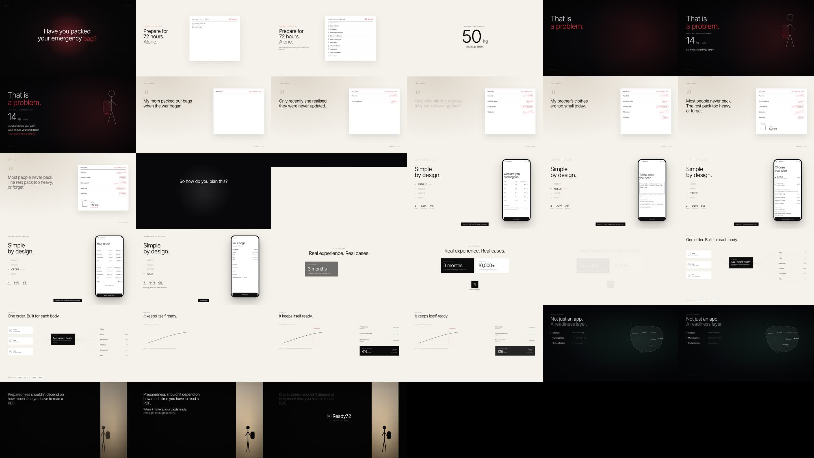
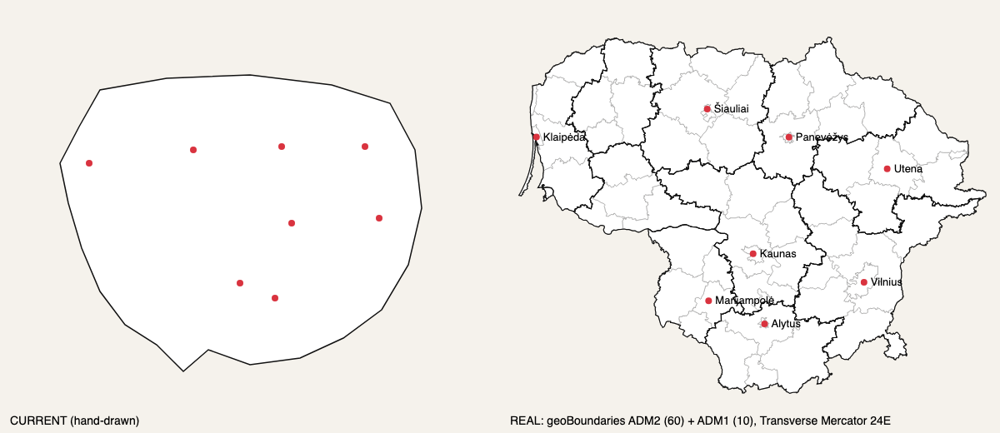

# Ready72: video and submission win plan

> **This is a plan only.** Nothing in the app or in the video was changed to produce it. The only files added are this document and the evidence in `docs/video-plan/` (a contact sheet of the current cut, a map comparison image and the small script that produced it).
>
> Audit date: **Fri 13 Nov 2026, about 17:30**. Hard deadline: **Sat 14 Nov, 20:00** (project and video demo on Devpost). That is about 26 hours, of which realistically 14–16 are working hours.
>
> Companion document: `HACKATHON_WIN_PLAN.md` (the app audit). This file does not repeat it. It references its IDs (`ENG-`, `UX-`, `P-`, `K-` …) where they matter for the video, and adds what that plan did not cover: the video, the submission package, evidence, and the prize levers.

---

## 0. Verdict and the 12 changes that matter most

**What we have:** a 2:46, 1080p, motion-graphics cut that looks tidy but that mostly *tells* instead of *shows*. Measured facts, not opinions:

- The product first appears at **1:13.5**, which is **44 % of the way in**. Only **28 s (17 %)** is the app, and it is static screenshots with a slow zoom.
- Narration and visuals are out of sync by **1.4 to 5.2 s** in the demo, **0.6 to 4.3 s** in Justa's story and **1.6 to 3.2 s** in the problem scene (tables in section 4.3).
- **38 text elements are 13 px or smaller on a 1920×1080 frame.** At 720p playback those are about 8 px. Several have a 2.3–2.5:1 contrast ratio.
- **At least eight on-screen claims cannot be defended** against our own repo (section 4.1). The headline number, "50 kg", is not reproducible from the repo's own transcription of the official list (27.99 kg).
- There is **no human on screen at all**, although the script opens with "a person waking up in the middle of the night" and closes with a woman taking the bag and leaving. Both are replaced by a stick figure.
- The voice is macOS `say`. There is no music, no sound design, no captions.
- The Lithuania map is a hand-typed 21-point polygon. It does not look like Lithuania (section 5).

**What the judges score** (official, from unfairweekend.com): *Technical Execution, Product Design, Potential Impact, Originality*. The pre-judges watch **every** submission video and pick the finalists who pitch live. The video is the gate. Today it shows zero seconds of the hard technical work and no evidence that any real person used the product.

### The 12 changes, in order

| # | Change | Why it matters | Section |
| --- | --- | --- | --- |
| 1 | **Lock a truth table** and delete or reword every claim we cannot prove (50 kg, 47 items, "10,000+ cases", "AI that learned", €30/year, Maxima/Iki/Senukai, Anna/Tomas, 9 L water, "shipments arrive") | Judges are explicitly told to reward *naming the limits*. One caught exaggeration costs more than any polish gains. | 4.1 |
| 2 | **Restructure the film**: product on screen by **0:45**, master cut **≤ 2:30**, one idea per scene | 44 % of runtime is setup today | 6 |
| 3 | **Replace screenshots with real Screen Studio recordings** of the running app, plus a real barcode scan on a phone | Targets the **Best Demo by Screen Studio** prize and the *Functionality* criterion | 9 |
| 4 | **Film real people and real objects**: the night wake-up, Justa's mum's 2022 bag, Justa on camera, the forest trip, five user tests | Replaces stick figures. This is also your evidence. | 7, 11 |
| 5 | **ElevenLabs voice, sound effects and music**, with word timestamps driving the timeline and captions | The scratch voice is the single biggest "rough" signal. Also targets **Best Project Built with ElevenLabs**. | 8 |
| 6 | **Show the hard thing**: per-person carry-limit bars, a guardrail catching an allergen, "No pets" parsed as no pets | This is the *Technical Execution* and *Originality* answer. It is invisible today. | 6, 10 |
| 7 | **Prove it with people**: 5 informal tests, one measured baseline (PDF vs app), one honest "real vs simulated" strip | The organisers' own evidence ladder puts "a real user completed the workflow" above everything we have | 11 |
| 8 | **Make it legible**: essentials at 36 px or larger, nothing under 24 px, burned-in captions, zoomed UI callouts | Phones, muted autoplay, 720p | 4.4, 4.9 |
| 9 | **Lithuania map from real data** (60 municipalities) **or cut the scene**. Rule: if the data pipeline is not working in 45 minutes, cut. | Currently the weakest visual in the film | 5 |
| 10 | **Ship four deliverables**, not one: master (Devpost), 45 s vertical vote cut (public vote opens Sat ~21:00), 20 s stage cold open (Sunday), thumbnail | The public vote decides 5 of the stage slots | 6, 13 |
| 11 | **Submission package**: repo with real commit history (there are **zero commits today**), hosted demo URL, APK, Devpost text, pre-existing-work disclosure | Rules: "Start from scratch at the event. Disclose any pre-existing work." | 13 |
| 12 | **Pick the prize levers deliberately**: Best Demo (Screen Studio), Best Project Built with ElevenLabs (in-app voice, not just the ad voice), Kilo Co-Found track (optional) | Three side prizes are within reach. The main prize does not need to be sacrificed for them. | 12 |

---

## 1. What we are optimising for (verified, with sources)

### 1.1 Facts from the organisers

| Fact | Value | Source |
| --- | --- | --- |
| Event | Unfair Weekend 2026, Vilnius, ISM University, 12–15 Nov | unfairweekend.com |
| Judging criteria (four) | **Technical Execution** ("Does it work, and does the build show real technical effort?"), **Product Design** ("Easy to use, and a complete product, not just a tech demo?"), **Potential Impact** ("Does it solve a real problem for a clear group of people?"), **Originality** ("Is the idea creative and different from what already exists?") | unfairweekend.com/#rules |
| Submission | "Project and video demo by **Sat, Nov 14 at 20:00**" | #rules |
| Public vote | Opens **Sat 14 Nov around 21:00** on `/voting`. **The five most-voted teams also pitch.** | #rules |
| Finals | Finalists pitch live **Sun 15 Nov from 12:00**. Judges' decisions are final. | #rules |
| Pre-judges | "Before Demo Day, they review **every submission** and pick the finalists who pitch on stage." (4 people) | unfairweekend.com/#judges |
| Judges (5) | Vinted (Senior Director, Product), Mistral (Director, Manufacturing Solutions), Kilo (Chief Business Development Officer), CyberCare (Head of AI Labs), ISM (Director, Entrepreneurship & Innovation) | #judges |
| Build rule | "Start from scratch at the event. **Disclose any pre-existing work.**" | #rules |
| Team | Solo or up to 6. "Teams of three tend to do best." | #rules |
| Main prizes | 1st €4,000 + credits and subscriptions, 2nd €2,000, 3rd €1,000 | #prizes |
| **Side prizes relevant to us** | **Best Project Built with ElevenLabs** (3 months Scale tier). **Best Demo by Screen Studio** (1-year subscription). **Kilo Co-Found track: AI agents for everyday well-being** (Founders' Dinner). Most Tokens Saved by condense (n/a unless we use an LLM). | #prizes, /news/kilo-co-found-special-track |
| Organisers' own advice | "Show it working", "**Name the limits: distinguish working features, sample data and unfinished parts**", "Build the demo backwards", "Prepare a backup recording", "Evidence ladder: a user paid or returned > a real user completed the core workflow > a customer made a pilot commitment > … > friends said the idea sounded cool" | /news/how-to-win-unfair-weekend |

**Not published (verify on the Devpost page tonight):** maximum video length, whether the video must be public or unlisted, accepted hosts, required aspect ratio. Until verified, assume **a hard 3:00 cap, public YouTube/Vimeo link**, and design for **≤ 2:30**.

### 1.2 What each criterion needs from the video

| Criterion | What a pre-judge needs to see in the first 2 minutes | In the current cut |
| --- | --- | --- |
| **Technical Execution** | The difficult part working: per-person carry limits, 16 guardrails, a needs parser that understands negation, barcode scanning, growth projection | **0 s**. The engine scene shows a generic diagram with invented content. |
| **Product Design** | Real UI, readable, real interactions, a complete journey (not mock-ups) | 28 s of static screenshots at 21 % of frame width |
| **Potential Impact** | A named user, a number that is true, evidence that someone tried it, a believable path to revenue | A story (strong) plus unverifiable numbers (weak). No user evidence. |
| **Originality** | One sentence of thesis they will remember | Not stated. Closest: "Every bag fits the person who carries it" (currently only in the demo script, not the film). |

### 1.3 Who watches, in order

1. **Four pre-judges**, one after another, probably muted at first, probably at 1.25× or skimming. They decide the finalists. **Optimise for this person first.**
2. **Public voters** from Sat 21:00, on phones, in feeds. They need a 30–45 s vertical cut with burned-in captions.
3. **Five judges** on Sunday, live, after a stage pitch. They need a strong 20 s opener and the master as backup.

### 1.4 Deliverables (target)

| Deliverable | Spec | Used for | Priority |
| --- | --- | --- | --- |
| **Master demo video** | 16:9, 1920×1080, ≤ 2:30, burned-in captions + `.srt`, −16 LUFS | Devpost, pre-judges, backup on stage | P0 |
| **Vote cut** | 9:16, 1080×1920, 30–45 s, captions burned in, QR + vote URL at the end | Public vote (opens Sat ~21:00) | P0 |
| **Stage cold open** | 16:9, 15–20 s, no voice-over (the presenter speaks live), siren and picture only | Sunday pitch | P1 |
| **Thumbnail / poster** | 1280×720 and 1080×1080 | Devpost, YouTube, social | P1 |
| **Backup recording of the live demo** | Screen Studio capture of the full flow, no edits | Sunday if anything fails | P0 |
| **Captions** | `.srt` EN (+ LT if time) | Accessibility, muted autoplay | P0 |

---

## 2. The current cut, measured

File: `video/out/ready72-ad.mp4`. Contact sheet (one frame every 5 s): `docs/video-plan/contact-sheet-current-cut.jpg`.



### 2.1 Technical spec

| Item | Value |
| --- | --- |
| Duration | 166.0 s (2:46) |
| Format | 1920×1080, 30 fps, H.264 (CRF 18), AAC |
| Size | 17 MB (20.7 MB before the loudness pass) |
| Loudness after `loudnorm` | mean −18.6 dB, peak −1.4 dB (raw: −22.6 / −4.1) |
| Audio | 10 narration clips (macOS `say`: Daniel ×6, Albert, Flo, Samantha ×2) + synthetic siren, drone and room tone from `ffmpeg` sine generators |
| Captions | none |
| Source | `video/src` (Remotion 4.0.543, React 19), `video/tools/vo.py` is ready for ElevenLabs but has never run (no API key) |

### 2.2 Where the time goes

| Scene | Time | Length | Share | What it actually communicates |
| --- | --- | --- | --- | --- |
| Cold open | 0:00–0:06 | 6.0 s | 3.6 % | Question on black. No person. |
| LT72 math | 0:06–0:21 | 15.0 s | 9.0 % | Invented checklist, "47 items", "50 kg" |
| Problem | 0:21–0:34.5 | 13.5 s | 8.1 % | Stick figure, "14 kg not 50", three questions |
| Justa | 0:34.5–1:05 | 30.5 s | **18.4 %** | Quote text, invented "bag audit" card |
| Transition | 1:05–1:13.5 | 8.5 s | 5.1 % | Text on black |
| **Demo** | **1:13.5–1:41.5** | **28.0 s** | **16.9 %** | **Static screenshots** |
| Engine | 1:41.5–2:18 | 36.5 s | **22.0 %** | Abstract diagrams, invented content |
| National | 2:18–2:32 | 14.0 s | 8.4 % | Broken map |
| Close | 2:32–2:46 | 14.0 s | 8.4 % | Stick figure, logo, "Thank you." |

**Before the product appears: 73.5 s (44.3 %). Product on screen: 28 s (16.9 %).** Judges who skim will leave before 1:13.

### 2.3 One-paragraph diagnosis

The cut is competent graphic design applied to the wrong problem. It is a **brand film**. The organisers want a **demo**: a person, a problem, a working product, the difficult thing visibly working, and proof. The structure, the proportions and almost every visual need to change. The existing assets worth keeping are: the concept of the opening question, Justa's story (as a person on camera), the scene backgrounds' restrained look (but not the 12 px uppercase labels), the real app screens, and the Remotion project as an assembly tool.

---

## 3. Scene-by-scene findings

Priorities: **P0** = blocks a win, **P1** = costs points, **P2** = polish. Effort: **S** < 1 h, **M** 1–3 h, **L** 3–8 h.

### Scene 1: Cold open (0:00–0:06)

What is there: black, red pulse, concentric rings, headline "Have you packed your emergency bag?" word by word, "03:47" and "VILNIUS" corner labels (13 px), "LITHUANIA · 72 HOURS" (14 px, 42 % white), a synthetic siren, a drone.

| ID | Finding | Fix | P | Effort |
| --- | --- | --- | --- | --- |
| VID-01 | **The script's first image is missing.** "It begins with dark, then sirens start, and show a person waking up in the middle of the night." There is no person, no bed, no phone light. | Film the 10–15 s night sequence (section 7, shots 1–5). Fallback: stock CC0 night-bedroom clip. Last resort: silhouette graphic. | P0 | M–L |
| VID-02 | The siren is a sine frequency sweep (`aevalsrc`). It sounds like a synthesiser, and the rings do not pulse with it. | Real siren recording (CC0) or ElevenLabs sound effects: "distant air-raid siren at night, urban, reverb, rising". Sync ring pulses or screen flicker to the audio's amplitude envelope. | P0 | S |
| VID-03 | The hook is delivered in 1 s of voice and 5 s of silence-free black. It is never contrasted with anything. | Use the 15 s hook structure in section 6. The question is the *end* of the sequence, not the whole of it. | P1 | M |
| VID-04 | The product name does not appear until 2:38. A viewer cannot say what this is for 2.5 minutes. | Title card at ~0:18: logo + "Be ready. Carry less." | P0 | S |
| VID-05 | Corner labels are 13 px, 42–50 % white. | Delete or raise to ≥ 28 px. | P2 | S |
| VID-06 | Hard cut from black to the warm-white LT72 scene (a flash). | Designed transition (section 14). | P1 | S |

### Scene 2: LT72 math (0:06–0:21)

What is there: "Prepare for 72 hours. Alone." plus a 20-row checklist card (invented rows) with "47 items", then a counter to "50 kg", "For a single person.", "That is not a bag. That is furniture."

| ID | Finding | Fix | P | Effort |
| --- | --- | --- | --- | --- |
| VID-07 | **The list is invented.** The script says "Show the LT72 list on screen." The card contains 20 rows I wrote (including "Drinking water · 9 L", "Whistle", "Dust masks"). | Show the real list: a screen recording scrolling `lt72.lt/isvykimo-krepsys-5` (the source in `lib/data/lt72.dart`), or the 81 transcribed rows. | P0 | S–M |
| VID-08 | **"50 kg" is not reproducible.** `lib/data/lt72.dart` has 81 rows summing to **27.99 kg** at one unit per row. At the *top* of the water range (4 L/day × 3 days = 12 kg instead of 6) it is **≈ 34 kg**. HACKATHON_WIN_PLAN.md (section 12) already flagged "check the ~28 kg figure". | Decide (section 18, D1): **(a)** re-derive 50 kg with a documented method and show it, **(b)** use the verifiable figure, **(c)** do a physical weigh-in on camera (best: it is evidence). Never show a number without a way to reproduce it. | P0 | S–L |
| VID-09 | "**47 items**" is invented. The transcription has **81** rows (13 critical, 47 important, 21 comfort; coincidence that "important" is 47). A judge who opens the repo sees the mismatch. | Use "81 items" or the verified count from the page. | P0 | S |
| VID-10 | "Water · 9 L" contradicts the app (1.5 L bottles, 3 L per adult; `DEMO_SCRIPT.md` Q&A explains why). | Use the real rows. | P0 | S |
| VID-11 | The "50" counter finishes **0.7 s before** the voice says "fifty kilograms". "For a single person." appears **1.7 s early**. | Drive cues from word timestamps (section 8). | P0 | M |
| VID-12 | "That is not a bag. That is furniture." is not in the script and is not spoken. | Keep as a voiced line or delete. | P2 | S |
| VID-13 | This is a **static slide**. The idea (too much stuff) is visual and physical. | Real weigh-in, or an animated pile of the real items stacking on a scale with a running total. | P1 | M–L |
| VID-14 | The "boring voice" is meant as comedy (the script labels it). Albert reads as unintentional robot. | ElevenLabs: deliberate deadpan delivery, one take that sounds human and bored. | P1 | S |

### Scene 3: Problem (0:21–0:34.5)

| ID | Finding | Fix | P | Effort |
| --- | --- | --- | --- | --- |
| VID-15 | The figure is a stick figure and the "50 kg" bag is a dashed rectangle floating at its side. It reads as a diagram error. | Replace with three real silhouettes or three real people holding bags: **you (70 kg: 14 kg)**, **your child**, **grandma (Ona: 7.4 kg)**. This foreshadows the per-person bars in the product. | P0 | M |
| VID-16 | The three questions appear **2.6 s, 2.0 s and 1.6 s before** the voice asks them. "Not 50" appears **3.2 s early**. | Timestamp-driven. | P0 | M |
| VID-17 | On-screen "That is a problem." vs spoken "That's a problem." (script: "Thats a problem…") | Match. | P2 | S |
| VID-18 | The most powerful number in the whole project is not here: **Ona, 71, 62 kg, insulin: 7.4 kg** (from `docs/DEMO_SCRIPT.md`: "Nobody tells her which 7.4."). | Use it as the emotional pivot. | P0 | S |
| VID-19 | The "20 % of body weight" label simplifies the real rule (one fifth plus age caps plus 15/12/10 kg ceilings; `docs/RESEARCH.md`). | Say "up to one fifth of body weight" and cite LT72 once on screen. | P1 | S |

### Scene 4: Justa (0:34.5–1:05, 30.5 s, 18 % of runtime)

| ID | Finding | Fix | P | Effort |
| --- | --- | --- | --- | --- |
| VID-20 | **No face.** "Justa" is a 12 px label. The most human part of the story is typography. | Justa on camera (phone is enough), or her voice over real photographs. | P0 | M |
| VID-21 | The "BAG AUDIT" card (Food kit EXPIRED 2023, Medicine EXPIRED 2022, Jacket 122 → 140 cm) is **fabricated data presented as her mother's bag.** | Use the **real bag** (if it still exists): unzip it on camera, macro on the real printed expiry dates, the real too-small jacket against the real brother. This is the single best asset available and it costs nothing. If the bag is gone, label the card "illustration". | P0 | M |
| VID-22 | **Text is up to 4.3 s late** (table 4.3). Beat 3 ("My brother's clothes…") shows at 13.1 s; she says it at 10.6 s. Beat 4 shows at 18.5 s; she says it at 14.2 s. | Timestamp-driven. | P0 | M |
| VID-23 | The audit rows (3–16 s) appear **before** the voice mentions expiry (21.6–28.9 s). | Same fix. | P0 | S |
| VID-24 | 30 s with almost no motion. | Compress to **12–14 s** (section 6). Keep one line: "Bags expire. Children grow." | P0 | M |
| VID-25 | Sensitive subject: a real family, a child (brother, 8), the war. | Get Justa's and her family's explicit consent. Avoid war imagery. Do not show the child's face without a parent's consent. | P0 | S |

### Scene 5: Transition (1:05–1:13.5)

| ID | Finding | Fix | P | Effort |
| --- | --- | --- | --- | --- |
| VID-26 | 8.5 s of text on black before the product. "WATCH HOW SIMPLE IT IS" is 15 px at 60 % red. | Cut to ≤ 2 s or fold into the title card. | P0 | S |

### Scene 6: Demo (1:13.5–1:41.5)

| ID | Finding | Fix | P | Effort |
| --- | --- | --- | --- | --- |
| VID-27 | **The screens are static widget-test golden images.** No typing, no taps, no transitions, no barcode scan, no real device. | Screen Studio recording of the real flow (section 9). | P0 | L |
| VID-28 | The phone is **404 px** wide on a 1920 px frame (21 %). App body text is 14 px at 390 px logical width, so it renders at about **15 px**. At 720p it is about 10 px. | Phone at full frame height with zoomed callouts for the 3–4 moments that matter. Let Screen Studio auto-zoom. | P0 | M |
| VID-29 | Captions lag the narration by **1.4 s, 2.0 s, 2.9 s, 3.9 s, 5.2 s** (table 4.3). The "Scan barcodes" caption appears 5 s after the voice says it. | Timestamp-driven cues. | P0 | M |
| VID-30 | Script items missing: "**Shipments from different stores arrive home**" (no visual), "**scan bar codes**" (no scan), "**put things in the bag according to the phone's recommendation**" (static list). | Shoot them (section 7, shots 18–20). | P0 | L |
| VID-31 | The narration says "**the AI asks** about health conditions…". The app does not ask. You type a sentence and an **on-device parser** extracts needs. | Say what is true: "tell it in your own words". | P0 | S |
| VID-32 | The left panel ("Simple by design", step list, stats) duplicates the narration and takes 55 % of the frame. | Remove. Use the space for the product. | P1 | S |
| VID-33 | Nothing shows the product's **idea**: bags matched to people. | Show the per-person carry-limit bars and let a number change when you edit someone's age or weight. (Needs APP-02.) | P0 | M |

### Scene 7: Engine (1:41.5–2:18, 36.5 s, 22 % of runtime)

| ID | Finding | Fix | P | Effort |
| --- | --- | --- | --- | --- |
| VID-34 | **Invented content that contradicts the app.** People "Anna 34·62, Mia, Ona". The app uses Jonas, Rūta, Mia, Ona. "Water 9 L". Stores "Maxima, Rimi, Iki, Barbora, Senukai": the app uses Barbora, Decathlon, Eurovaistinė, Rimi. "Children size 92". | Generate the diagram from the real optimiser output (`PlanResult`) for the demo family. | P0 | M–L |
| VID-35 | The script's explicit visual cue, "*(a diagram is shown: which items go to which person)*", is **not delivered**. Today's diagram shows *categories* going to a box. | Items flying into four bags with fill percentages. Real data. | P0 | L |
| VID-36 | The growth chart is a hand-typed array in `Engine.tsx` (`pts`). "128 cm", "March 2027", "June 2027" are invented. The app has a real model (`lib/domain/growth.dart`). | Screenshot or render the real projection. | P1 | M |
| VID-37 | "**10,000+ real emergency preparation cases**" is a number I created from your word "thousands". The repo's data pipeline is **13 manual samples** (`docs/REPORT.md`). | Remove. See 4.1. | P0 | S |
| VID-38 | Text is **10–13 px** throughout (labels, chips, rows). | Redesign. | P0 | M |
| VID-39 | 36 s of abstract diagrams at the point where judges decide whether the engineering is real. | Replace with 20 s of **proof**: a guardrail catching a nut-allergy swap, a child-plus-pet household that no longer crashes, the negation test, the 62 tests. | P0 | M |

### Scene 8: National readiness (2:18–2:32)

| ID | Finding | Fix | P | Effort |
| --- | --- | --- | --- | --- |
| VID-40 | The map is a hand-typed polygon (section 5). | Real data, or cut. | P0 | M |
| VID-41 | "Retailers · Municipalities · Civil protection" reads as **existing partnerships**. They are plans. | Label "Next" or "Vision". | P0 | S |
| VID-42 | Dot labels are 12.5–15 px. | ≥ 28 px or remove. | P1 | S |

### Scene 9: Close (2:32–2:46)

| ID | Finding | Fix | P | Effort |
| --- | --- | --- | --- | --- |
| VID-43 | The script's last image ("the woman who got up from the sirens takes the bag and leaves") is a stick figure walking in front of a light rectangle. | Real shot (section 7, shot 24). | P0 | M |
| VID-44 | **No call to action.** No URL, no QR, no team name, no "Built at Unfair Weekend 2026", no Devpost mention. The last frame is "Thank you." | End card (section 6, shot 25). | P0 | S |
| VID-45 | The brand logo is a boxed "72" + "Ready72". The app icon is a large white "72" on near-black with "READY72" underneath (`web/icons/Icon-512.png`). They do not match. | Use the real icon everywhere. | P1 | S |

---

## 4. Cross-cutting findings

### 4.1 Claims audit (what the video says versus what the repo can prove)

| # | Claim in the video | Where | What the repo shows | Verdict | Action |
| --- | --- | --- | --- | --- | --- |
| 1 | "50 kilograms for a single person" | VO02, Lt72 scene | `lib/data/lt72.dart`: 81 rows, **27.99 kg** (≈ 34 kg at the water upper bound) | **Not reproducible** | D1. Re-derive, weigh on camera, or change |
| 2 | "47 items" | Lt72 card | 81 rows | **Invented** | Use the real count |
| 3 | "AI that learned from thousands of emergency preparation cases" | VO07 | No ML. Deterministic parser. Reddit pipeline = 13 manual samples. | **Unsupported** | D2. Reword to something true |
| 4 | "10,000+ real emergency preparation cases" | Engine card | Nothing | **Invented** | Delete |
| 5 | "The AI asks about health conditions, allergies and pets" | VO06 | App does not ask. User types free text; parser runs on-device. AI client exists but is **never called** (`docs/REPORT.md`). | **Misleading** | Rephrase |
| 6 | "Aggregates Lithuanian store offers into one" | VO07 | Static catalogue. **16 Barbora rows verified live on 13 Nov**; the rest are estimates. 0 Decathlon prices verified. | **Overstated** | "One order across four stores" and say the prices are demo data |
| 7 | "Shipments arrive from Lithuanian stores to your home" / "Delivered from Lithuanian stores to your home" caption | VO06, Demo caption | Checkout is mocked, deliveries are simulated | **Misleading as shown** | Label **Prototype: simulated checkout** on screen. The organisers ask for exactly this. |
| 8 | "€30 per year subscription" (your script) | script, earlier cut | App: **€16/month** (= €192/year, **6.4×** more) | **Contradiction** | D3. One number everywhere |
| 9 | Engine: Anna/Tomas/Mia/Ona, 9 L water, Maxima/Iki/Senukai, size 92 | Engine scene | App: Jonas/Rūta/Mia/Ona, 1.5 L bottles, Barbora/Decathlon/Eurovaistinė/Rimi | **Contradicts the app** | Generate from real output |
| 10 | Bag audit: "EXPIRED 2023", "SIZE 122 · NOW 140" | Justa card | Fabricated | **Fabricated as fact** | Real bag or label "illustration" |
| 11 | Growth chart, "128 cm", "March 2027", "June 2027" | Engine act C | Hand-typed; the app has a real model | **Fabricated** | Real output |
| 12 | "Partnerships with retailers… municipalities and civil protection" | VO08, National | None exist | **Vision, shown as fact** | Label "Next" |
| 13 | "Three months in the forest" | VO07, Engine card | Your claim, nothing on screen | **Plausible, unproven** | Show 5–10 s of footage or photos |
| 14 | "60 municipalities" | National | geoBoundaries ADM2: **60** features | **Verified** | Keep |
| 15 | "Four bags. Every one within carry limit." | Demo | 0 blockers, 0 dropped. But **Jonas 14.9/15 = 99.3 %** | True, but brittle | Fix APP-03 |
| 16 | "Real app, real data" caption | Demo | Widget-test screenshots of the example family | Fair, but say "example family" | Reword |

**Why this matters beyond honesty:** the pre-judges include a Head of AI Labs and a product director from a marketplace. They will ask "which part is AI?" and "where do the prices come from?". The organisers' own checklist says "Name the limits." The film should do that deliberately, in one strip near the end: **Real**: carry-limit engine, 16 guardrails, 62 tests, on-device needs parser, 16 live Barbora prices (13 Nov). **Simulated**: checkout, delivery, payments. **Next**: retailer integration, municipal pilots.

### 4.2 Fidelity to your script

| Script beat | In the film | Status |
| --- | --- | --- |
| Dark, sirens, **person wakes** | Text on black | ✗ missing person |
| "Have you packed your emergency bag?" (deep) | ✓ | OK |
| Boring voice: LT72 list **on screen** | Invented list | ✗ |
| "50 kilograms for a single person" | ✓ said, unverifiable | ⚠ |
| "70 kg person can carry 14 kg, not 50" | ✓ | OK |
| "What should you take / your child / your grandma?" | Text, early | ⚠ sync |
| Justa: mum, Ukraine, bag not updated, 8-year-old brother | Voice ✓, face ✗ | ⚠ |
| "Many people don't pack… too heavy… expired…" | Voice ✓ | ⚠ sync |
| "Watch how simple it is." | ✓ | OK |
| Flight attendant: step one (family) | ✓ screen | ⚠ sync |
| Step two: **AI asks** about health, grandma has diabetes | Static screen, wrong verb | ✗ |
| Step three: two tiers, order | ✓ screens | ⚠ sync |
| **Shipments from different stores arrive** | no visual | ✗ |
| **Scan bar codes** to set expiry reminders | no scan | ✗ |
| **Put things in the bag according to the phone** | static list | ✗ |
| "You are ready :)" | ✓ | OK |
| Pro man: forest experience + AI cases | text card | ⚠ claims |
| **Diagram: which items go to which person** | generic categories | ✗ |
| Projects children's height, reminders, subscription | invented chart | ⚠ |
| National readiness tool, partnerships | broken map, reads as fact | ⚠ |
| "Preparedness shouldn't depend on… a PDF." | ✓ | OK |
| **Woman wakes from sirens, takes the bag, leaves** | stick figure | ✗ |
| "Thank you." | ✓ | OK, but no CTA |

The flight-attendant framing is a genuinely original idea (the safety-card parody: "In case of emergency…"). It is currently invisible. See section 6 for how to use it as the demo's visual language.

### 4.3 Narration versus picture: measured offsets

All offsets are **seconds**. Positive = the visual comes *after* the voice (late), negative = before (early). Voice phrase times come from `ffmpeg silencedetect` (−32 dB, 0.18 s) on the clips in `video/public/audio`; visual times are the frame numbers in the scenes.

**Justa (voice starts at 1.0 s into the scene)**

| Beat | Voice says it at | Text appears at | Offset |
| --- | --- | --- | --- |
| "My mom packed our bags when the war began" | 1.0 | 0.5 | −0.5 |
| "Only recently she realised they were never updated" | 6.5 | 7.1 | **+0.6** |
| "My brother's clothes are too small today" | 10.6 | 13.1 | **+2.5** |
| "Most people never pack. The rest pack too heavy, or forget." | 14.2 | 18.5 | **+4.3** |
| Audit rows ("Food kit EXPIRED" …) | 21.6–28.9 | 3.0–15.7 | **−18 to −6** |

**Demo (voice starts at 0.67 s into the scene)**

| Beat | Voice says it at | Screen/caption at | Offset |
| --- | --- | --- | --- |
| "Step two" | 4.5 | needs screen 6.3, caption 6.5 | **+1.8 / +2.0** |
| "Step three, pick between two tiers" | 8.6 | plan screen 11.3, caption 11.5 | **+2.7 / +2.9** |
| "Shipments arrive from Lithuanian stores" | 11.6 | order screen 15.3, caption 15.5 | **+3.7 / +3.9** |
| "Scan barcodes…" | 14.1 | pack screen 19.2, caption 19.4 | **+5.0 / +5.2** |
| "You are ready" | 21.9 | home screen 23.3, caption 23.5 | **+1.4 / +1.6** |

**Problem (voice starts at 1.0 s)**

| Beat | Voice | Text | Offset |
| --- | --- | --- | --- |
| "Not 50" | 6.5 | 3.3 | −3.2 |
| "So what should you take?" | 7.6 | 5.0 | −2.6 |
| "What should your child take?" | 9.0 | 7.1 | −2.0 |
| "How about your grandma?" | 10.8 | 9.1 | −1.6 |

**LT72:** "50" is on screen at 10.7 s, the voice says "fifty kilograms" at about 11.2 s (−0.5). "For a single person." text 11.0 s, voice 12.7 s (−1.7).
**Engine:** act C starts at 24.0 s; "The model projects children's height" is said at 22.3 s (+1.7). "€16" card at 28.3 s; "16 euros a month" said at about 29.8 s (−1.5). "10,000+" card at 1.3 s; "thousands of cases" said at 6.4 s (−5.1).

**Root cause:** scene lengths and cue frames were estimated, then the voice was dropped on top. Fix by making the **voice the clock**: generate the voice first, get word timestamps, derive every cue (section 14). This also makes the ElevenLabs swap painless (today, replacing the voice breaks every cue).

### 4.4 Legibility and contrast

- **38 text elements at ≤ 13 px** on a 1920×1080 canvas (10 px ×6, 11 px ×4, 12 px ×20, 13 px ×7), plus 14–18 px for most remaining body text. At 720p they scale by 0.67.
- Measured contrast (WCAG): `#9A9A9A` on paper `#F5F2EC` = **2.52:1** (needs 4.5:1). White at 28–30 % on near-black = **2.3–2.5:1**. Hairline `#DED9CF` on paper = 1.26:1 (fine for lines, not text). Red `#D9333F` on paper at 12 px = 4.18:1 (fails for small text).
- **Rule for the rebuild (design for a phone, in a feed, at 720p):**
  - Anything the viewer must read: **≥ 36 px** (display ≥ 72 px).
  - Secondary labels: **≥ 28 px**.
  - Nothing below **24 px**, ever. If it does not fit, it is not needed.
  - UI screenshots: never rely on reading the UI text itself. **Zoom 2–3×** on the one region that matters, or add a 36 px callout.
  - Minimum contrast 4.5:1 for text, 3:1 for large text.

### 4.5 Visual identity

- App: white `#FFFFFF`, ink `#111111`, grey `#6B6B6B`, Inter Light, square corners, 52 px black button (`lib/theme/design.dart`).
- Film: adds warm paper `#F5F2EC`, near-black `#050506`, red `#D9333F`, green `#2F6B4F`, film grain, glow, pulsing rings, 20+ tracked uppercase 12 px labels. The overall look is the **template minimalism** that reads as machine-made: uppercase letter-spaced micro-labels, radial glows, rings, grain, identical fade-up on every element (the same 26 px translate, the same easing, 18 frames).
- Fix: one small token file shared by the film and the screenshots; fewer, bigger elements; real photography and real screen footage carry the emotion; typography does the structure only.

### 4.6 People and authenticity

The film has **zero humans**. The product is about children, a grandmother and a mother. The script is full of people. Authentic footage is also the cheapest way to look expensive: a phone, a lamp and two people. Stick figures and abstract silhouettes should be the last fallback. (Shot list in section 7.)

### 4.7 Motion and transitions

- Every scene uses the same entrance. Scene changes are hard cuts (dark to light flashes at 0:06, 0:21, 1:05).
- Add: designed transitions with sound (`@remotion/transitions`), match cuts (bag in closet → bag on scale), push-ins on UI, whip pans on the three big moments (name reveal, plan appears, scan beep).
- Keep stillness for emotion (the unboxed 2022 bag; the grandmother's 7.4 kg).

### 4.8 Audio

| Problem | Evidence | Fix |
| --- | --- | --- |
| Scratch voice | macOS `say`; five roles use four stock voices; "professional man" and "deep voice" are the same voice (Daniel) | ElevenLabs, distinct voices per role (section 8) |
| No music | none | 60–70 BPM bed that lifts at the demo; or restraint (no music in the story, music from the demo) |
| No sound design | none | Siren, phone buzz, zipper, tap, scan beep, ticks, scale clunk, whoosh (list in section 8) |
| Synthetic siren/drone/room | `aevalsrc`/`anoisesrc` | Real recordings or ElevenLabs SFX |
| Mono, no ducking | VO mono at fixed gain; beds fixed | Stereo mix, duck beds 8–12 dB under VO |
| Loudness | raw mean −22.6 dB; fixed by a post-hoc `loudnorm` | Mix to −16 LUFS integrated, true peak ≤ −1.5 dBTP, measured with `ebur128` |
| No captions | none | Burned-in + `.srt` |
| Dense speech | 142 s of speech in 166 s (86 %) | Cut to about 100–110 s of speech in a 150 s film (70 %), with silences used on purpose |

### 4.9 Accessibility and captions

- No captions: the film is unwatchable muted (most pre-judges will start muted).
- Contrast and size as in 4.4.
- Colour is not the only carrier (red/green used for state).
- Flicker: the red pulse is about 0.5 Hz; the siren rings are slow. No photosensitivity risk. Keep it that way.
- Provide `.srt` EN and, if time, LT.

### 4.10 Pipeline, repository and operational risks

| Risk | Evidence | Fix |
| --- | --- | --- |
| **The git repo has zero commits** | `git log`: "your current branch 'main' does not have any commits yet" | **First commit tonight**, push to a remote. Also proof of work done at the event. P0. |
| **The whole `video/` folder is git-ignored** | root `.gitignore`: "Video/Remotion workspace (separate deliverable)" | Put the video source in the repo (ignore only `node_modules`, `out`, raw footage) or in its own repo. A dead laptop must not kill the deliverable. |
| `video/node_modules` is **973 MB** | `du` | Keep ignored. Never commit. |
| Chrome path hard-coded | `remotion.config.ts` points to `/Applications/Google Chrome.app/...` because Remotion's bundled headless shell never loads the page on macOS 26 (Remotion issue #12633) | Read from env var `REMOTION_BROWSER` with a documented fallback. |
| Timeline hard-codes scene lengths, cue frames and VO offsets | `Video.tsx` lines 14–22, 100–109; every scene file | A **timeline manifest** generated from VO timestamps (section 14). |
| Every full render takes roughly 5–10 min | Observed | Use Studio for iteration, `--frames` ranges and `--scale 0.5` for review; full render only for checkpoints. |
| Screenshots generated by a widget test that locates the Flutter SDK path at runtime | `test/screenshots_test.dart` | Fine for a draft. Final = real recordings. |
| Remotion licence | Free for individuals and companies of up to 3 people (remotion.dev/docs/license/pricing). The hackathon allows teams up to 6. | Confirm eligibility for your team size before Sunday. If more than 3 are on the team, read the FAQ or switch the final assembly to another tool (Screen Studio + a timeline editor) for the final export. Note: Remotion Creators seat is $25/month/seat if you do need a licence. |
| `loudnorm` was applied as a separate manual step | `ready72-ad.mp4` vs `ready72-ad-raw.mp4` | Bake into the render script with a two-pass measurement. |

### 4.11 Legal, ethics, licensing

| Item | Action |
| --- | --- |
| Justa, her mother and her brother (8) are real people in a war-related story | Written or recorded consent. No child face without a parent's consent. Do not use stock war imagery. |
| Emergency-alert realism | Do not imitate an official Lithuanian alert screen. A generic siren and a lit phone are enough. |
| Retail brand names (Barbora, Rimi, Decathlon, Eurovaistinė) | Names are fine as nominative use. Do not use their logos in a way that implies partnership. |
| Map data | **OpenStreetMap-derived (ODbL)** if you use geoBoundaries: attribute "© OpenStreetMap contributors" on the map and in the Devpost description. Natural Earth is public domain. |
| Fonts | Inter is OFL; fine. |
| Music and SFX | Use ElevenLabs outputs (check that your plan's licence covers commercial use) or CC0/YouTube Audio Library. Keep a `CREDITS.md`. |
| Health content | The app never suggests doses. Say "bring your prescription" and show a one-line disclaimer once. |
| ElevenLabs voices | Only use library or custom voices you may use commercially. Do not clone a real person without consent. |

---

## 5. Lithuania map

### 5.1 Why the current map is wrong (evidence)

`video/src/scenes/National.tsx` draws the country from a **21-vertex polygon typed by hand** (line 18–19) plus a separate curve for the Curonian Spit, and places eight city dots by guessing coordinates in the same made-up space. I wrote it from memory. That is the cause: a memory-drawn shape has no topology. Compare:



| | Current | Real (Natural Earth 1:10m) |
| --- | --- | --- |
| Vertices | **21** | **556** |
| Silhouette | smooth blob with a notch at the bottom | jagged north border with Latvia, the Curonian Spit, the long eastern bulge, the southern peninsula towards Druskininkai |
| City dots | positions guessed (Klaipėda is inland, Vilnius sits on the border) | placed from real coordinates; Klaipėda on the coast, Vilnius in the south-east |
| Area | not computed | **64,635 km²** (official ≈ 65,300; −1 %) |

**Should Claude draw it by hand more carefully instead?** No. Hand-placed coordinates would give a slightly better blob. The honest options are real data or no map. The comparison image above was produced from real data in a few seconds, so the data route is cheap.

### 5.2 Data sources (all checked)

| Source | What you get | Licence | Verdict |
| --- | --- | --- | --- |
| **geoBoundaries gbOpen, Lithuania ADM2** | **60 municipalities**, simplified GeoJSON, 16,133 vertices, 462 KB. Source: OpenStreetMap (Wambacher), year 2017. | **ODbL 1.0** (attribute "© OpenStreetMap contributors") | **Recommended**: matches the "60 municipalities" line and lets municipalities light up |
| geoBoundaries gbOpen, Lithuania ADM1 | **10 counties**, 7,708 vertices, 216 KB | ODbL 1.0 | Use for stronger county lines |
| **Natural Earth 1:10m admin-0** (via npm `world-atlas@2.0.2`, ISC; data is public domain) | Country outline only, 556 vertices | Public domain | Good fallback for an outline-only map |
| Official Lithuanian open data (data.gov.lt / geoportal.lt / Registrų centras) | Authoritative boundaries | Check each dataset (many are CC BY 4.0) | Worth one 5-minute look; **do not rely on it** tonight |
| Wikimedia Commons "Maps of Lithuania" | Ready SVGs | Per file (often CC BY-SA or public domain) | Fine for a static background; hard to animate municipalities |
| OpenStreetMap / Overpass | Raw boundary relations | ODbL | More work than geoBoundaries |
| GADM | Admin boundaries | **Non-commercial, no redistribution** | **Avoid** |
| Screenshots from Google/Apple Maps | any | Terms of service | **Avoid** |

Pinned download URLs (used in the proof):

```
https://github.com/wmgeolab/geoBoundaries/raw/9469f09/releaseData/gbOpen/LTU/ADM2/geoBoundaries-LTU-ADM2_simplified.geojson
https://github.com/wmgeolab/geoBoundaries/raw/9469f09/releaseData/gbOpen/LTU/ADM1/geoBoundaries-LTU-ADM1_simplified.geojson
npm: world-atlas@2.0.2  (countries-10m.json; Lithuania is feature id "440")
```

### 5.3 The pipeline (proof already ran; see `docs/video-plan/map-pipeline-proof.mjs`)

1. Download the two GeoJSON files into `video/data/` (pinned URLs above).
2. **Rewind the rings.** *Pitfall found while proving this:* geoBoundaries GeoJSON follows RFC 7946 (counter-clockwise exterior rings), but `d3-geo` expects clockwise rings on the sphere. Without rewinding, `d3.geoArea` returns **3.26 × 10¹⁰ km²** (the complement of the country) and fills invert (the whole canvas turns white). After reversing each ring, the 60 municipalities sum to **64,602 km²**. Use `geojson-rewind`, `@turf/rewind` (`reverse: true`) or reverse the coordinate arrays.
3. Project with `d3.geoTransverseMercator().rotate([-24, 0])` (central meridian 24° E, the same family as Lithuania's national grid LKS-94 / EPSG:3346; the 0.9998 scale factor is irrelevant for a graphic). Fit to the slide with `fitExtent`.
4. Convert each feature to an SVG path string; write `video/src/data/lt-municipalities.json` (`{ id, name, d, centroid:[x,y] }[]` + `outline` + `counties`).
5. Optionally simplify to about 3,000–5,000 vertices with `mapshaper adm2.geojson -simplify 15% keep-shapes -o adm2-simple.geojson` so 60 paths animate smoothly.
6. Place cities from real lon/lat (table in Appendix C) through the same projection.
7. Write UTF-8 everywhere (the first proof render had mojibake in "Šiauliai", "Klaipėda": the HTML lacked `<meta charset="utf-8">`).

### 5.4 Animation brief (if the scene stays)

- The outline draws on with `@remotion/paths` (`evolvePath`), 1.2 s.
- The 60 municipalities fade in as a ripple outward from Vilnius (stagger by distance from the Vilnius centroid), 0.9 s.
- Eight to ten city dots with labels at **≥ 28 px** in a clear sans, only the top three labelled at once.
- A single message: "**60 municipalities. One standard.**" and the word **Next** or **Vision** on the chip. It must not read as a claim that municipalities have signed up.
- Attribution in 24 px in a corner: "Map data © OpenStreetMap contributors".
- Stretch (only if everything else is done): the installed `remotion-maps` skill supports MapLibre/Mapbox/Cesium for a 3D fly-over. High effort, low scoring value.

### 5.5 Acceptance tests (the map is "done" only if all pass)

1. 60 municipality shapes and 10 county shapes render; no inverted fills.
2. Bounding box: lon **20.9–26.8**, lat **53.9–56.5**.
3. Summed area within **2 %** of 65,300 km².
4. Klaipėda on the coast, Vilnius in the south-east, Kaunas central; compare against OSM.
5. Curonian Spit visible; north border jagged, not smooth.
6. All text ≥ 28 px at 1920×1080, contrast ≥ 4.5:1.
7. Attribution present.
8. 60 fps preview does not stutter in Remotion Studio.

### 5.6 Decision rule

The map adds little to the judges' scores. It is a mood beat, not evidence. **If the pipeline is not rendering correctly within 45 minutes of starting, cut the scene** and replace it with a 6 s "Next" strip (retailers, municipalities, civil protection) on a plain background. Time saved goes to the demo footage, which scores.

---

## 6. Target film: structure, storyboard and script v2

### 6.1 Principles

1. **Show the product by 0:43**, not 1:13.
2. **One idea per scene**; every scene earns its seconds against the four criteria.
3. **Demo backwards** (the organisers' advice): the strongest 60 seconds are the plan appearing with per-person bars, the nut-allergy catch, the real barcode scan, "Ready for 72 hours". Everything else serves those.
4. **Real over rendered**: real people, real objects, real recordings.
5. **The voice is the clock.** Cues come from word timestamps.
6. **Honest labels** on anything simulated.
7. **Thesis on screen once:** "Every bag fits the person who carries it."

### 6.2 Master cut (target 2:30, 16:9)

| # | Time | Shot | Source | Voice (see 6.3) | On-screen text (≥ 36 px) | Sound |
| --- | --- | --- | --- | --- | --- | --- |
| 1 | 0:00–0:03 | Black. A bedside clock reads **03:47**. | Real | none | none | low room tone, distant siren, clock tick |
| 2 | 0:03–0:06 | Siren swells. A phone lights up the ceiling. A hand reaches. | Real | none | none | siren rises, phone buzz |
| 3 | 0:06–0:09 | She sits up, looks toward a closet. | Real | **Deep:** "Have you packed your emergency bag?" | the question, on the last word | siren ducks under voice |
| 4 | 0:09–0:12 | Closet. The bag packed in 2022. Zipper. | Real | none | none | zipper, breath |
| 5 | 0:12–0:16 | Macro: printed expiry dates. A small jacket held against a real child. | Real | none | "Packed 2022." (optional lower-third) | silence, one low tone |
| 6 | 0:16–0:19 | **Title card.** | Graphic | none | **Ready72** / *Be ready. Carry less.* | siren cuts, clean tone |
| 7 | 0:19–0:24 | The official LT72 list scrolling (real page). | Screen recording | **Deadpan:** "Lithuania's LT72 guide tells us to prepare for 72 hours without help. We opened the list. It's long." | "LT72 · 81 items" (use the true count) | page scroll |
| 8 | 0:24–0:29 | **Everything on the list on a scale.** Number climbs. | Real weigh-in, or animation from the data | "We weighed everything on it: {X} kilograms. For one person." | "{X} kg" | scale clunk, ticks |
| 9 | 0:29–0:33 | **Ona**, 71, 62 kg, insulin. A bar labelled **7.4 kg** next to the {X} kg pile. | Graphic from real numbers | **Deep:** "Ona can carry seven point four. Nobody tells her which seven point four." | "7.4 kg" | soft low note |
| 10 | 0:33–0:43 | **Justa** to camera and the real photos. | Real | **Justa:** "My mum packed our bags when the war began in Ukraine. Years later nobody had updated them. My brother's clothes didn't fit. The food had expired." | "Bags expire. Children grow." (lower-third) | no music; room tone |
| 11 | 0:43–0:50 | **Family.** Four people entered (Jonas 34/82, Rūta 32/64, Mia 2/13, Ona 71/62). A small limit appears under each (Ona: 7.4 kg). | Screen Studio | **Attendant (cheerful):** "Welcome to Ready72. Step one: who is packing?" | "01 Family" | tap sounds, music enters |
| 12 | 0:50–1:00 | **Needs.** Type: "Grandma Ona has diabetes and takes insulin. Mia is 2 and still in diapers. We have a dog." Chips appear under Ona and Mia. Then edit to "We don't have a dog": the dog chip disappears. | Screen Studio | "Step two: say it in your own words." | "02 Needs · on your phone" | typing, soft chip pops |
| 13 | 1:00–1:03 | **Consent.** Tick, "Agree and build". | Screen Studio | none | "Health data stays on this device" | click |
| 14 | 1:03–1:11 | **Plan builds.** Four weight bars fill and stop at each person's limit. "9 of 9 critical groups". | Screen Studio (needs APP-02) | "Step three: every bag is fitted to the person who carries it." | "Ona 6.7 / 7.4 kg" zoomed | bars rise, tick |
| 15 | 1:11–1:17 | Toggle **Essential €351 / Comfort €473**. Tap Ona: insulin cooling pouch, low-sugar food. | Screen Studio | "Choose Comfort or Essential." | "Ona · insulin pouch" | tick |
| 16 | 1:17–1:21 | **Order**: four stores, total. | Screen Studio | "One order across four stores." | "Prototype · checkout simulated" (small, clear) | tap |
| 17 | 1:21–1:25 | Place order, confirmation, tracking. | Screen Studio | none | none | success chime |
| 18 | 1:25–1:28 | **Boxes arrive** at a door (or stylised stack). | Real or animation | "Scan what arrives." | none | knock, boxes |
| 19 | 1:28–1:34 | **A real product is scanned** on a real phone (second camera over the shoulder). The row checks. | Real + device capture | "Pack by phone." | none | barcode beep |
| 20 | 1:34–1:38 | Home: **"Your bags. Ready for 72 hours."** Four weights. | Screen Studio | "You're ready." | "Ready for 72 hours" | resolve chord |
| 21 | 1:38–1:50 | **How it fits.** Items fly from the catalogue into four bags, each stopping at its limit. A nut-allergy swap is caught by a rule and replaced. | Generated from real optimiser JSON | **Pro (low):** "Sixteen safety rules check every bag before you see it: weight, water, calories, allergies, medicine. It all runs on your phone." | "16 rules · 62 tests · on-device" | quiet |
| 22 | 1:50–1:58 | **Keeps itself fresh.** Mia's size projection, expiry dates, **€16/month**, an approval card: "Replace Ona's insulin cool-pack gel? Approve". | Screen Studio / real growth model | "It watches expiry dates and how fast the children grow, and asks before it replaces anything." | "€16 / month · family" | tick |
| 23 | 1:58–2:16 | **Proof and next.** Five test families (clips, 3 s each), the measured baseline, forest photos (3–5 s), the **Real / Simulated / Next** strip. Optional 6 s map. | Real + graphic | "We tested it with five families. {Result}. Next: one-click ordering with retailers, and plans for every household with municipalities and civil protection." | "Real · Simulated · Next" | music lifts |
| 24 | 2:16–2:22 | She takes the bag and leaves through the door into light. | Real | **Deep:** "Every bag fits the person who carries it." | none | door, steps, silence |
| 25 | 2:22–2:30 | **End card**: logo, URL, QR, team, "Built at Unfair Weekend 2026". | Graphic | none | link + QR (QR ≥ 220 px) | tone fades |

Total **2:30**. Speech about **105 s** (70 %), not 86 %.

### 6.3 Script v2 (proposal; numbers in `{braces}` need your decision)

Tightened from your script and corrected so every claim is true. Keep your voice and your jokes; the flight-attendant register is yours and is kept.

- **Deep:** "Have you packed your emergency bag?"
- **Deadpan:** "Lithuania's LT72 guide tells us to prepare for seventy-two hours without help. We opened the list. It's long. We weighed everything on it: {X} kilograms. For one person."
- **Deep:** "An adult can carry about a fifth of their body weight. Ona is seventy-one, takes insulin, and can carry seven point four kilograms. Nobody tells her which seven point four."
- **Justa:** "My mum packed our bags when the war began in Ukraine. Years later, nobody had updated them. My brother's clothes didn't fit. The food had expired."
- **Attendant:** "Welcome to Ready72. In the event of an emergency, please keep your family seated. Step one: tell us who is packing. Step two: say what you need in your own words. Step three: choose Comfort or Essential and order. Scan what arrives. Pack by phone. You're ready."
- **Pro (low):** "Sixteen safety rules check every bag before you see it: weight, water, calories, allergies, medicine. It all runs on your phone. It watches expiry dates and how fast the children grow, and it asks before it replaces anything."
- **Pro:** "We tested it with five families. {Result}. Next: one-click ordering with retailers, and a plan for every household, with municipalities and civil protection."
- **Deep:** "Every bag fits the person who carries it."

Rules for any line you edit: **≤ 2.7 words per second**, one idea per sentence, no claim without a source in the repo.

### 6.4 Flight-attendant device (your idea, made visible)

The script's flight-attendant voice is an original device that the film currently wastes. Options, cheapest first:

1. **Voice only** with safety-card pictogram overlays during shots 11–20 (airline-card line drawings: "Add family", "Tell us", "Scan", "Pack"). Effort M.
2. **HeyGen avatar** of the attendant (HeyGen Creator plan is included; skills `heygen-avatar` and `heygen-video` are installed) in a 6–8 s picture-in-picture. HeyGen's own skill says it is not for b-roll, so use it only for a talking presenter. Effort M and costs credits.
3. **A real person** in a simple uniform scarf. Highest charm, highest effort.

Pick **option 1** unless someone on the team wants to act.

### 6.5 Vote cut (9:16, 45 s) for the public vote that opens Sat ~21:00

| Time | Content |
| --- | --- |
| 0:00–0:05 | Night, siren, phone light, she wakes (shots 1–3), burned-in caption "Have you packed your emergency bag?" |
| 0:05–0:12 | "{X} kg. For one person." then "**Ona can carry 7.4**" (shots 8–9) |
| 0:12–0:32 | Demo montage: family → sentence → bars fill → scan beep → "Ready for 72 hours" (shots 11, 12, 14, 19, 20) |
| 0:32–0:40 | Proof: "5 families tested", one 3 s quote, "Real / Simulated / Next" |
| 0:40–0:45 | CTA: **"Vote Ready72"** + QR + `unfairweekend.com/voting` (verify the exact URL when it goes live) |

Specs: 1080×1920, captions burned in at ≥ 56 px, safe area 120 px top and 220 px bottom, first frame is already interesting, no intro.

### 6.6 Stage cold open (Sunday, 15–20 s)

Shots 1–6 with siren and picture only (no voice). The presenter says the opening question live as the title lands.

---

## 7. Footage production plan

**Time constraint:** it is already dark in Vilnius (sunset is around 16:00 in mid-November). **Shoot the night shots tonight.**

| Shots | What | Who | Where / when | Gear | Time | Fallback |
| --- | --- | --- | --- | --- | --- | --- |
| 1–3 | Clock, phone light, hand, sitting up | Justa (or any adult on the team) | A bedroom, tonight, lights off | Phone camera on a tripod (or books), 4K 24/30 fps, manual exposure locked; the bedside lamp and phone screen as the only light | 45 min | Stock CC0 night bedroom clip, edited in |
| 4–5 | The **real 2022 bag**, zipper, expired dates, the child's jacket | Justa + her brother (with a parent's consent) | At home, tonight or tomorrow morning | Phone, macro (get within 8 cm), window light | 30 min | A staged bag. **Label it "reconstruction".** |
| 8 | Weigh-in of the list's items on a scale | Anyone | Tomorrow morning | Luggage or kitchen scale; water bottles and a few stand-in objects | 45 min | Data animation (the numbers come from `lt72.dart`) |
| 10 | Justa to camera, plus photos of the real bag and family | Justa | Window light, tomorrow morning | Phone, lavalier (optional), a quiet room | 30 min | Her voice-over on photographs |
| 18 | Boxes arrive at a door | Anyone | Tomorrow | Phone | 15 min | Animated stack |
| 19 | **A real product scan**, over-the-shoulder, with the phone screen visible | Anyone | At the venue or kitchen | Two phones: one scanning, one filming. The scanned products must be ones whose EAN is in the catalogue (CAT-04 in `HACKATHON_WIN_PLAN.md`) | 30 min | Manual EAN entry on screen (weaker) |
| 23 | Five test sessions (clips) | Participants | Venue, Saturday | Screen Studio or phone | 60 min total | Written quotes |
| 23 | Forest trip photos or clips (3–5 s) | Whoever has them | existing | none | 15 min to find | Omit the claim |
| 24 | She takes the bag and leaves, backlit by a doorway | Same actress | Hallway, tonight | Phone, door light behind her | 20 min | Silhouette in doorway, no face needed |

**Shoot rules:**

- Shoot **horizontal 4K** and keep the subject in the centre 40 % of the frame so the vertical cut can crop without a reshoot.
- Lock exposure and white balance. Do not use digital zoom. 1/50 shutter at 24/25 fps.
- Record 20 s of **room tone** and 20 s of each location for sound.
- Get **written or recorded consent** from every person on camera. Ask the parent for the brother.
- Do not film any real emergency-alert screen. Use a lit phone with the normal lock screen.

**Order of the day:** tonight 1–5 and 24 (about 90 min). Tomorrow morning 8, 10, 18, 19. Tomorrow midday 23.

**If there is no time to shoot:** accept the fallback column, but spend it deliberately. The real 2022 bag (shots 4–5) is the one item worth finding time for; it costs nothing and nobody else will have it.

---

## 8. Audio plan (ElevenLabs first)

### 8.1 What the tools can do (checked in the installed SDK 2.78.0)

`text_to_speech`, `text_to_speech.convert_with_timestamps`, `text_to_sound_effects`, `music.compose`, `speech_to_text`, `voices`, `dubbing`, `conversational_ai` are all present. **Verify tonight** that your plan includes Music and what the commercial-use terms are.

### 8.2 Voices (roles from your script)

| Role | Direction | Notes |
| --- | --- | --- |
| Deep voice | low, close, calm, slow (about 140 wpm) | Current `vo.py` candidates: George, Daniel, Brian, Adam |
| Deadpan (the "boring" voice) | flat on purpose, human, mildly bored | Do not mistake robotic for boring. Try a voice that sounds like a civil servant. |
| Justa | warm, natural, a bit shy, slight accent welcome | Prefer **her own voice** on camera; use a synthetic voice only for voice-over over photos |
| Flight attendant | bright, reassuring, a little theatrical | Separate from Justa |
| Professional man | low, measured, different from the deep voice | Today he is the same voice as the narrator |

Model: `eleven_v3` for expressive roles (audio tags such as `[whispers]` are used in `vo.py`; **verify** the current tag list). Fall back to `eleven_multilingual_v2` (the script strips tags automatically).

**Lithuanian:** do not assume Lithuanian is supported by the model you pick. **Verify language support** before promising a Lithuanian voice-over. If unsure: English voice-over with Lithuanian subtitles.

### 8.3 Pipeline

1. Export the final script (6.3) to `video/tools/lines.json` (id, role, text).
2. For each line call **`convert_with_timestamps`** and save both the mp3 and the character-level alignment JSON.
3. Derive **word cues** (word, start, end) and a **line manifest** (line start/end). Everything in the film keys off these. Compute silences from the alignment instead of `silencedetect`.
4. Pronunciation: spell "LT72" as "L T seventy-two"; check **Ona** (OH-nah), **Rūta** (ROO-tah), **Jonas** (YO-nas) and "Lietuva". Use a pronunciation dictionary or respelling if the model stumbles.
5. Review takes with eyes closed. Regenerate any line that sounds synthetic. Keep two takes of each.
6. Master each voice: high-pass 80 Hz, light compression, de-ess if needed, normalise peaks to −6 dBFS.

### 8.4 Sound effects and music

Use `text_to_sound_effects` (and `music.compose` if included) with prompts like these. Keep the generated files in `video/public/audio/sfx` and list them in `CREDITS.md`.

| Cue | Prompt idea |
| --- | --- |
| Siren | "distant air-raid siren at night over a quiet city, slowly rising, natural reverb" (real recording if you can find CC0) |
| Phone buzz | "phone vibrating on a wooden bedside table" |
| Clock | "digital alarm clock tick, quiet bedroom" |
| Zipper | "backpack zipper opening slowly" |
| Scale | "bathroom scale settling with a small mechanical clunk" |
| UI tick | "soft interface tap, short, warm, no sparkle" |
| Barcode beep | "retail barcode scanner beep, single, clean" |
| Success | "short resolving two-note chime, warm" |
| Whoosh | "soft whoosh transition, 0.4 seconds" |
| Door | "apartment door opening, footsteps on a wooden floor" |
| Music | "sparse piano and low strings, 64 BPM, minor, tense; lifts to hopeful major at 0:43; instrumental" |

Keep the music **off during the story (shot 10)**. Bring it in at 0:43, lift it at 2:00, resolve at 2:22.

### 8.5 Mix targets

| Element | Target |
| --- | --- |
| Integrated loudness | **−16 LUFS** (YouTube normalises to about −14 and will turn loud files down; do not over-compress) |
| True peak | ≤ −1.5 dBTP |
| Voice peaks | about −6 dBFS |
| Beds under voice | duck **8–12 dB** with a 120 ms attack and 600 ms release |
| SFX | −18 to −12 dB relative to voice |
| Format | stereo, 48 kHz, AAC 256 kbps |
| QA | `ffmpeg -i out.mp4 -af ebur128=peak=true -f null -` and check clipping with `astats` |

### 8.6 Captions

- Burned-in captions for the master and the vote cut: **≥ 36 px** (master), **≥ 56 px** (vertical), max two lines, 42 characters per line, white on a 50 % black pill.
- Source: the alignment timestamps from 8.3. Remotion's `remotion-captions` skill is installed.
- Export `.srt` for Devpost/YouTube.

---

## 9. Product demo capture (Screen Studio)

**Why this matters:** it targets **Best Demo by Screen Studio**, it replaces the static screenshots, and it is the *Functionality* evidence. The app already runs on web, macOS and Android.

### 9.1 Setup

| Item | Choice |
| --- | --- |
| Surface | The **web build** at phone size in a clean Chrome window (390×844 logical, DPR 2–3), **or** the Android phone mirrored with `scrcpy --show-touches`. Prefer the real phone for shots 19–20. |
| Screen Studio | Install is done (`/Applications/Screen Studio.app`). Redeem the event's free-month code at checkout (the code is on the participant page; keep it out of the repo). **Verify whether it can record a USB-connected iPhone** before planning around it. |
| Settings | 60 fps, smooth cursor, auto-zoom on clicks, hide desktop icons and notifications, do-not-disturb on, battery full |
| State reset | Settings → delete all data; or `adb shell pm clear <package>` for the phone |
| Language | English first. Capture a second pass in Lithuanian only if time remains |
| Data | Use the **example family** (Jonas/Rūta/Mia/Ona). For shot 12 type the sentence live |

### 9.2 Runbook (do three clean takes of each segment, not one long take)

1. **Welcome → Family** (shot 11): enter or load the family; show the limit hint per person (needs APP-02/F-6).
2. **Needs** (shot 12): type the sentence; chips appear under Ona and Mia; then change "a dog" to "no dog" and show the dog chip disappear. This is the negation fix (AI-01) shown as proof.
3. **Consent → Plan** (shots 13–14): tick, build, **let the bars animate**; hold 2 s on the final state.
4. **Tier toggle + Ona's bag** (shot 15).
5. **Order** (shots 16–17): four stores, place order, tracking.
6. **Pack on the real phone** (shots 19–20): scan a real product (second camera), see it check, finish, land on Home.
7. **Backup**: one uncut take of the whole flow in 3 minutes for Sunday.

### 9.3 Quality bar

- No error banners, no keyboard glitches, no 4-second pauses. Re-record rather than hide.
- The cursor or touch dot is always visible and moves with intent.
- Zoom on the thing that matters (the bars, the chips, the beep). Never show a full-screen of 14 px text without zooming.
- Export 4K if Screen Studio allows; downscale to 1080p in the edit for crispness.

---

## 10. App changes that matter for the video and the judges

The app audit (`HACKATHON_WIN_PLAN.md`) is largely implemented (62 tests pass). Reviewing the real screens captured on 13 Nov shows what remains. **App feature freeze: Saturday 10:00.** After that, only bug fixes, because the demo recordings must come from a stable build.

| ID | Finding (seen in the 13 Nov screenshots) | Why it matters for the film | Related | P | Effort |
| --- | --- | --- | --- | --- | --- |
| APP-01 | **Order shows delivery statuses before the order is placed.** The Order screen (before "Place order") already lists "On the way", "Packed", "Ordered". | A pre-judge will notice the inconsistency in shot 16. | NEW | P0 | S |
| APP-02 | **The thesis is not visual.** Plan and Pack show per-person weights as text only (`Jonas 14.9 / 15 kg`). There is no carry-limit bar. | Shots 11, 14, 20 and the "how it fits" shot need it. It is the one visual that explains the idea in 3 s. | `P-3`, `UX-10`, `F-6` (still open) | P0 | M |
| APP-03 | **Bags sit at the limit.** Jonas **14.9/15 = 99.3 %**, Rūta 11.6/12.8 = 90.6 %, Ona 6.7/7.4 = 90.5 %, Mia 0.21/0.39 = 53.8 %. A product that says "Carry less" should leave headroom (and the user's own phone, keys, documents). | A sharp judge will ask. | `ENG-02` (85–90 % target) | P1 | M |
| APP-04 | **Item counts are high for "simple":** Jonas 34 items, Rūta 43, Ona 24, Mia 2. The Pack list is 24 undifferentiated rows. | The demo feels long. | NEW | P1 | M |
| APP-05 | **Pack list has duplicates and confusing owners:** "ARIMEX bread seed mix 100 g ×2" appears three times with different people; Ona's bag lists "AKVILĖ still mineral water 1.5 l · Rūta" (shared load, but unexplained). No thumbnails. | Confuses the shot where the viewer should feel "this is easy". | `ENG-16` | P1 | M |
| APP-06 | **Decathlon is 56.5 % of the basket** (€267.21 of €473) with 29 items; delivery Wed 18 Nov (5 days) against a "72 hours" story. | Judges from Vinted-type product teams will ask about the basket. Prepare the answer or rebalance. | `CAT-01`, `ENG-12` | P1 | S–M |
| APP-07 | **Store names differ from the film** (film said Maxima, Iki, Senukai; app has Barbora, Decathlon, Eurovaistinė, Rimi). | Fix in the film. | VID-34 | P0 | S |
| APP-08 | **Welcome**: about a third of the screen is empty, "· 3 Order and keep it fresh" wraps onto an orphan line, no logo or illustration. | First frame of the demo. | `W-4` (open) | P1 | S |
| APP-09 | **Family and Needs**: a large blank area above the title (vertical centring). | Wastes the most valuable pixels in every demo frame. | NEW | P2 | S |
| APP-10 | **Home**: a bare list of four links (View plan / Order status / Settings / Start over). "Start over" sits among them with no warning. No readiness score, next expiry or "grab and go" action. | It is the final frame of the demo. | `UX-04` | P1 | M |
| APP-11 | **No imagery or icons anywhere**: monochrome typography only. Warm and trustworthy matters for a product about children and grandparents. | Visual interest in shots 14–15. | NEW | P2 | M |
| APP-12 | **Subscription**: €16/month (€192/year) versus your script's €30/year. A child (€5) costs more than an adult (€4) with no explanation on screen. | One number everywhere (D3). | `ENG-25`, `S-4` | P0 | S |
| APP-13 | **Real barcodes**: only 16 Barbora rows carry verified data and all EANs in the catalogue are synthetic. Scanning a real product in shot 19 fails. | You need three real products whose EANs are in the catalogue. | `CAT-04` | **P0** | S–M |
| APP-14 | **Agency**: the "keeps itself fresh" idea is text on the subscription screen. The Kilo brief asks for *an agent that acts and asks permission*. | A small "approval card" ("Replace Ona's cool-pack gel? Approve / Skip") in shot 22 would show agency and a permission model. | Kilo track | P2 | M |
| APP-15 | **Voice** is not in the product. | Required for the "Best Project Built with ElevenLabs" prize (section 12). | NEW | P1 | M |
| APP-16 | **Hosted demo + APK**: not deployed yet. | Judges click links. | `OPS-02..04` | **P0** | S–M |
| APP-17 | **Demo-state shortcut for filming**: a hidden way to land on any screen with the example family loaded. | Saves 20 minutes of re-takes. | NEW | P1 | S |

**What to prove in the demo (the hard thing):** the video should include one moment where the product catches something a person would miss. The best candidates, all already implemented and tested:

1. A nut-allergy swap (guardrail catches an allergen in a snack and replaces it).
2. A household of one child and a dog now produces a plan or an honest gap instead of crashing.
3. "We don't have a dog" removes the dog chip (negation).
4. Changing Ona's weight or age live changes her limit and her bag.

Pick **three** of these. Do not try to show all.

---

## 11. Evidence and impact plan

The organisers rank evidence explicitly. We currently have none on screen. Plan for **three kinds**, each cheap:

### 11.1 Five informal user tests (about 60 minutes in total, Saturday midday)

- Who: two parents, one person over 60, one non-technical friend, one mentor at the venue. No coaching.
- Task: "Plan emergency bags for your family." Observe silently. Record screen and voice with consent.
- Measure: time to plan, number of hesitations, whether they finished, whether they would order, whether they would pay **€16/month**.
- Output: **one headline** ("4 of 5 built a plan in under two minutes without help"), **three 3-second quote clips**, and one thing that went wrong (show it; fix it if you can).
- Keep it honest: n = 5, informal, say so.

### 11.2 A measured baseline

Time yourself building one family's bags from the official LT72 page by hand (a spreadsheet) versus the app. If it is 25 min vs 90 s, say that, once, with the method on screen. This also settles the 50 kg question if you weigh the items.

### 11.3 A sourced anchor for impact

- One sourced Lithuanian statistic on household preparedness (the civil protection service or a survey). **Do not invent or round one.** If you cannot find a source tonight, say nothing numeric about the market and let the five tests carry the impact.
- Try for **one expert line** (a mentor with civil-protection, retail or medical-logistics experience, e.g. the Cencora and Ordero mentors listed on the event page) that you may quote on screen with their permission.

### 11.4 The honest slide

A single 6 s strip near the end, in three columns:

| **Real** | **Simulated** | **Next** |
| --- | --- | --- |
| carry-limit engine · 16 safety rules · 62 tests · on-device parser · 16 live Barbora prices (13 Nov) | checkout · delivery · payment | retail ordering · municipal pilots · EU-hosted backend |

This is the "name the limits" advice turned into a design element, and it pre-empts the hardest Q&A.

### 11.5 Business

You need one believable number. The app already has the data to compute it: for the example family, the perishable items' replacement cost per year (price × 12 / shelf-life months for food and consumables) against the €192/year subscription. Compute it from `lib/data/catalogue.dart`; do not guess. State the channel in one line (retailer referral, municipal or employer sponsorship for vulnerable residents) and label it "Next".

### 11.6 Pre-existing work

State once, in the Devpost description and on the end card if there is room: *what was built this weekend* (the app, the optimiser, the demo film) and *what pre-dates it* (the 3-month forest experience, Justa's family story, any prior code or research). The rules ask for disclosure and the repo's lack of commit history will otherwise look like a gap.

---

## 12. Prize levers

| Prize | What it takes | Feasible in 26 h? | Recommendation |
| --- | --- | --- | --- |
| **Best Demo by Screen Studio** | The demo video is recorded and cut with Screen Studio | **Yes**, it is the plan in section 9 | **Do** |
| **Best Project Built with ElevenLabs** | The *project* uses ElevenLabs, not just the film voice | Yes, cheaply, see below | **Do** (P1) |
| **Kilo Co-Found track** (AI agents for everyday well-being) | An agent that owns a recurring job, remembers, acts with permission, has a retention loop, a measurable outcome. Direction #2 ("AI household OS for family health") and the open category fit. | Partially. Ready72's recurring job is *keeping a household ready*; add the approval card (APP-14) and say so in one sentence. | **Optional**, low cost |
| Most Tokens Saved by condense | An LLM-heavy app | No | Skip |
| Main prizes | All four criteria | Yes | Focus |

**ElevenLabs in the product without breaking the privacy story.** The app promises that no health text leaves the device. Two integrations keep that true:

1. **Spoken guidance for seniors and low-vision users (recommended).** Generate, **offline and once**, short audio clips of the static phrases (item names such as "Insulin cooling pouch", steps such as "Pack Ona's bag") in English (and Lithuanian if supported), bundle the clips as assets, and add a "Read aloud" button on Pack and a spoken "grab and go" sequence on Home. **No API key in the app, no network, no health text.** Effort M. It is also a real accessibility feature for Ona.
2. **Voice input for needs** (speech-to-text) would send audio containing health information to a third party. Only do this with an explicit consent line and a server-side key proxy. **Not recommended tonight.**

In the video, show the read-aloud button once (shot 20 or 22). That is what makes the claim "built with ElevenLabs" visible.

**The AI claim.** Your script says "AI that learned from thousands of cases". The app runs a deterministic on-device parser; the DeepSeek client exists but is never called. Decide (D2):

| Option | Pros | Cons |
| --- | --- | --- |
| **A. Honest on-device engine (recommended)**: "16 safety rules, on-device, bilingual" | True; strong privacy story; no demo risk | Less buzzwordy; judge from an AI lab may press on "where is the AI?" |
| B. Real LLM extraction behind a server proxy with explicit consent | Satisfies "AI" | A day of work; privacy story changes; demo risk |
| C. Keep the claim | None | Not defensible. Do not do this. |

Option A plus ElevenLabs voice plus a generated-from-data diagram is the strongest defensible story.

---

## 13. Submission package

### 13.1 Checklist

| # | Item | Notes | Due |
| --- | --- | --- | --- |
| 1 | **Git: first commit and push** to a remote | Zero commits today. Commit messages should be honest and timestamped. | Fri night |
| 2 | **Video source in the repo** | Reverse the `video/` ignore (keep `node_modules`, `out`, raw footage ignored) | Fri night |
| 3 | **Hosted web demo URL** | `make web` output; test on a phone over mobile data | Sat 14:00 |
| 4 | **Signed APK** | Release-signed; install on a real device and run the full flow | Sat 14:00 |
| 5 | **Devpost project page** | Title, tagline, description (see 13.2), built-with list, links, team | Sat 17:00 |
| 6 | **Master video** uploaded to YouTube (public or unlisted: verify the rule), title, description, captions (`.srt`) | Allow 10–30 min of processing | Sat 17:00 |
| 7 | **Thumbnail** 1280×720 | Title + one striking frame | Sat 17:00 |
| 8 | **Screenshots** (5–6) from the real app | Family, needs with chips, plan with bars, order, pack, home | Sat 17:00 |
| 9 | **Pre-existing work disclosure** | One short paragraph | Sat 17:00 |
| 10 | **Attribution** | "Map data © OpenStreetMap contributors" if the map is used; ElevenLabs; Remotion; Inter | Sat 17:00 |
| 11 | **Backup recording** (uncut demo) | On disk and uploaded unlisted | Sat 17:00 |
| 12 | **Vote cut + QR + captions for posts** | Ready before 21:00 | Sat 20:30 |
| 13 | **Submit** | Hit submit by **19:30**. Do not use the last 30 minutes for submitting. | Sat 19:30 |

### 13.2 Devpost description structure

1. **One-line**: "Ready72 builds a 72-hour emergency bag for every person in your family, and keeps each bag light enough for that person to carry."
2. **The problem** (3 sentences, one real person: Ona, 71, 62 kg, insulin, 7.4 kg).
3. **What it does** (the three-step flow).
4. **What is real / simulated / next** (the honest strip, in text).
5. **How it works** (carry-limit rules, 16 guardrails, on-device parser, 62 tests, verified prices).
6. **What we tested** (five families, the result).
7. **Built with**: Flutter, Dart, Remotion, ElevenLabs, Screen Studio, Claude and Codex (if used), OpenStreetMap data.
8. **What we built this weekend vs before**.
9. **Links**: web demo, APK, repo, video.

---

## 14. Rebuilding the pipeline so edits stop costing hours

Goal: after the voice, footage and recordings are in, **changing one line should re-time the whole film automatically**, and a full re-render should be needed only at checkpoints.

| # | Change | Detail |
| --- | --- | --- |
| PIPE-01 | **Cue manifest** | `video/tools/vo.py` writes `video/src/data/cues.json`: per line `{id, role, start, end, words:[{w,start,end}]}`, produced from `convert_with_timestamps`. Scene and cue frames are computed from it, never typed by hand. |
| PIPE-02 | **Dynamic duration** | `Root.tsx` uses `calculateMetadata` to set `durationInFrames` from the manifest. |
| PIPE-03 | **One `Timeline` file** | Scenes are `{ id, from(line id), to(line id), pad }`. `Video.tsx` maps them to `TransitionSeries` items. |
| PIPE-04 | **Transitions** | `@remotion/transitions` (fade, slide, wipe) with a matching SFX per transition. Keep every transition under 12 frames. |
| PIPE-05 | **Captions** | Generate from word cues; `remotion-captions` skill and `@remotion/captions`. Components: `Caption` (16:9), `CaptionVertical` (9:16). |
| PIPE-06 | **Footage** | Screen Studio exports and phone clips go in `video/public/footage/`. Use `OffthreadVideo` (or `@remotion/media`) with `trimBefore/trimAfter`. Proxy copies at 1080p for iteration. |
| PIPE-07 | **Audio bus** | Voice, SFX, music as three arrays in the manifest; **ducking** computed from voice cue ranges inside the `volume` callback; stereo; no hard-coded frame offsets. |
| PIPE-08 | **Four compositions** | `Master` (1920×1080), `Vote` (1080×1920), `StageOpen` (1920×1080, no voice), `Thumb` (still 1280×720). Shared components, different layouts. |
| PIPE-09 | **Design tokens** | `theme.ts` aligned with `lib/theme/design.dart` plus a type scale with a **24 px floor** (lint it: `grep -rn "fontSize: ([0-9]|1[0-9]|2[0-3])\b" src` must return nothing). |
| PIPE-10 | **Real data in, not typed** | Export the optimiser's `PlanResult` for the demo family to `video/src/data/plan.json` (a small Dart script using `PlanOptimizer`; the old `tool/` scripts are gone, so add `tool/export_plan.dart`). The "how it fits" shot reads it. Also export the growth projection from `lib/domain/growth.dart`. |
| PIPE-11 | **Components to build** | `BarMeter` (the carry-limit bar, same look as the app's), `LowerThird`, `Callout` (zoomed UI region), `RealSimNextStrip`, `QRCard`, `CaptionPill`. |
| PIPE-12 | **Render scripts** | `npm run render:master`, `render:vote`, `render:stage`, `still:thumb`, `qc`. Chrome path from `REMOTION_BROWSER` (default the macOS Chrome path). Loudness: two-pass `loudnorm` inside the script, not by hand. |
| PIPE-13 | **QC script** | `ffprobe` duration/streams, `ebur128` (target −16 LUFS, TP ≤ −1.5), `astats` for clipping, `silencedetect` for dead air > 1.2 s, frame-sheet export every 5 s. Fail the script if any check fails. |
| PIPE-14 | **Iteration rules** | Studio for iteration; `--frames` ranges and `--scale 0.5` for review; full 1080p render only at checkpoints (Sat 15:00 v1, Sat 16:30 final). |
| PIPE-15 | **Housekeeping** | Commit `video/` source (ignore `node_modules`, `out`, raw footage). Add `video/CREDITS.md` and `video/README.md` (how to render). |
| PIPE-16 | **Test hygiene (introduced during the draft)** | `test/screenshots_test.dart` and `test/goldens/*.png` are not tagged `golden`, so `make test` and CI run them and they will fail the moment any pixel of the UI changes. Tag with `@Tags(['golden'])` or move to a `tool/` script; do not leave a pixel test in the default suite. |
| PIPE-17 | **Small app fix made during the draft** | `lib/l10n/app_en.arb` and `app_lt.arb`: `⋯` (U+22EF, missing from Inter) replaced with `···` so the expiry hint renders. Keep it; mention it in the changelog. |

---

## 15. QA checklist for every export

**Content**

- [ ] Every number on screen appears in the truth table (4.1) with a source in the repo or a measurement we made.
- [ ] No claim of AI training, partnerships or live prices.
- [ ] "Prototype · checkout simulated" visible whenever ordering or delivery appears.
- [ ] The Real / Simulated / Next strip is on screen for ≥ 5 s.
- [ ] Names and stores match the app (Jonas, Rūta, Mia, Ona; Barbora, Decathlon, Eurovaistinė, Rimi).
- [ ] Consent confirmed for every person on camera.

**Sync**

- [ ] Every caption and on-screen cue lands within **±0.3 s** of the word it matches (spot-check ten cues).
- [ ] No visual is more than 0.3 s ahead of the voice.

**Legibility**

- [ ] Export a 720p copy, watch it on a phone at arm's length: every text is readable.
- [ ] Nothing below 24 px; essentials ≥ 36 px; contrast ≥ 4.5:1.
- [ ] The five-second test: show frame 0:30, 1:00, 1:30 for 5 s to a stranger; they can say what the product is.

**Audio**

- [ ] −16 LUFS integrated, true peak ≤ −1.5 dBTP, no clipping.
- [ ] Voice intelligible on a phone speaker and on laptop speakers.
- [ ] Muted playback still tells the story (captions).
- [ ] No synthetic-sounding line left. No dead air > 1.2 s unless intentional.

**Technical**

- [ ] Master ≤ 2:30; vote cut ≤ 45 s; stage open ≤ 20 s.
- [ ] 1080p H.264 ≥ 12 Mbps, AAC 256 kbps, yuv420p, MP4 `+faststart`.
- [ ] QR scans from the screen at 2 m. URL typed correctly.
- [ ] End card readable for ≥ 6 s.
- [ ] Final file opens in QuickTime and in a browser.

**Submission**

- [ ] YouTube processed at 1080p; captions attached; link works logged out.
- [ ] Devpost preview shows the video, screenshots and links.
- [ ] Web demo and APK tested from a phone on mobile data.

**Review**: two people who have not seen it watch the master once, silently, and write the answer to "what does it do, who is it for, would you use it" in one line each. If the lines disagree with ours, fix the film.

---

## 16. Schedule (anchored to the clock) and cut lines

Times are local. **Sleep is in the plan:** a tired team ships a worse video than a rested one.

| When | Block | Output |
| --- | --- | --- |
| **Fri 17:30–18:30** | **Decide and unblock.** Resolve D1–D5 (section 18). Get the ElevenLabs key (Discord coupon, then API key). Redeem Screen Studio. **First git commit and push.** Verify the Devpost video rules. Lock script v2. Assign roles. | Truth table, locked script, keys, repo |
| **Fri 18:30–20:30** | **In parallel:** (A) ElevenLabs voice + timestamps, voice casting; (B) app P0: APP-01, 02, 07, 12, 13 start; (C) map proof: if not rendering right by 22:00, cut. | `cues.json`, first voice pass, bars in the app |
| **Fri 20:30–22:00** | **Night shoot**: shots 1–5 and 24 (about 90 min), including the real 2022 bag macro. | Raw footage + room tone |
| **Fri 22:00–23:30** | Timeline manifest in Remotion (PIPE-01..03), export `plan.json` (PIPE-10), commit. | Voice-driven skeleton that renders |
| **Fri 23:30–08:00** | **Sleep.** | |
| **Sat 08:00–10:00** | Morning shoot: shots 8, 10, 18, 19 setup. Prepare **three real products** whose EANs are in the catalogue. | Footage |
| **Sat 10:00** | **App feature freeze.** After this, only bug fixes. | Stable build, hosted web + APK |
| **Sat 10:00–12:00** | **Screen Studio recordings** (section 9), three takes each. Record the uncut backup. | Footage + backup |
| **Sat 12:00–13:00** | **Five user tests** + the baseline timing. | Clips, a headline, a quote |
| **Sat 13:00–15:30** | **Assemble master v1**: footage, voice, captions, SFX, music, title/end card, real strip. Map or cut. | `Master v1` |
| **Sat 15:30–16:30** | Review by two fresh viewers; collect notes. | Notes |
| **Sat 16:30–17:30** | Fixes, final render (master + vote), QC script. | Final files |
| **Sat 17:30–18:30** | Upload to YouTube, Devpost page, screenshots, thumbnail, links tested from a phone. | Draft submission |
| **Sat 18:30–19:30** | **Buffer.** Submit by **19:30**. | Submitted |
| **Sat 20:00** | Deadline. | |
| **Sat 20:30–21:00** | Post the vote cut (QR + link). | Vote kit live |
| **Sat 21:00** | Public vote opens. | |
| **Sun morning** | Stage cold open, pitch rehearsal ×3, backup recording on the stage laptop. | Ready |

### Cut lines (what to drop first when behind)

1. **Map scene** (cut at Fri 22:00 if not rendering correctly).
2. Lithuanian captions/voice.
3. In-app read-aloud (keep the ElevenLabs *film* voice).
4. Approval card (APP-14).
5. Stage cold open (re-use the master's first 19 s).
6. The weigh-in (use the animation from data).
7. Never cut: real recordings of the app, the Real/Simulated/Next strip, captions, the end card, the git commit, the submission buffer.

### Risks

| Risk | Likelihood | Mitigation |
| --- | --- | --- |
| ElevenLabs key or plan limit not ready | Medium | Edit with the scratch voice, keep cues keyed to line IDs, swap later. Generate short lines first. |
| Lithuanian not supported by the chosen model | Medium | English voice, Lithuanian subtitles |
| Remotion render breaks again on macOS 26 | Low (known fix) | `REMOTION_BROWSER` → installed Chrome. Keep a working render script from Friday. |
| App unstable during recording | Medium | Feature freeze at 10:00. Keep an uncut backup. |
| Real barcode scan fails on camera | Medium | Practise tonight; keep the manual-EAN take as backup |
| Consent not given / no actor | Low–Medium | Silhouette or stock, label "reconstruction" |
| YouTube processing slow | Medium | Upload by 17:30. Unlisted preview first. |
| Devpost problems | Low | Start the page early, save drafts, screenshot every step |
| Laptop or disk failure | Low | Commit and push; copy `footage/` to a second drive |
| Remotion licence ineligible | Unknown | Check the FAQ for your team size; fall back to another editor for the final assembly if needed |
| Fatigue | High | Sleep block, shift decisions earlier, stop adding after 16:30 |

---

## 17. Master task list

Priority: P0 must, P1 should, P2 if time. Effort: S < 1 h, M 1–3 h, L 3–8 h. "Criterion" is the judging criterion it helps most: **TE** Technical Execution, **PD** Product Design, **PI** Potential Impact, **OR** Originality.

| WP | Work package | Covers | Crit. | P | Effort | Depends on |
| --- | --- | --- | --- | --- | --- | --- |
| WP1 | Truth table and script v2 (remove or reword unsupported claims) | VID-08, 09, 10, 31, 37, 41; 4.1 | PI | P0 | S | D1–D3 |
| WP2 | Git commit/push, video source in repo, hosted web demo, signed APK | 4.10, 13.1 | TE | P0 | S–M | none |
| WP3 | ElevenLabs voices, timestamps, cue manifest | 8.3 | PD | P0 | M | key |
| WP4 | Voice-driven timeline refactor (manifest, `calculateMetadata`, transitions) | PIPE-01..04, 07 | PD | P0 | M–L | WP3 |
| WP5 | Night shoot (shots 1–5, 24) | VID-01, 43 | OR | P0 | M | actor, consent |
| WP6 | Real 2022 bag + Justa on camera (shots 4–5, 10) | VID-20, 21, 24, 25 | PI | P0 | M | consent |
| WP7 | Real LT72 list + weigh-in (shots 7–8), re-derive the number | VID-07, 08, 09, 13 | PI | P0 | M | D1 |
| WP8 | App P0: APP-01, 02, 07, 12, 13, 16 | section 10 | PD, TE | P0 | L | none |
| WP9 | Screen Studio recordings of the real flow | VID-27, 28, 29, 33 | PD, TE | P0 | L | WP8, freeze |
| WP10 | Real barcode scan shot (shot 19), three real EANs in the catalogue | VID-30; APP-13 | TE | P0 | M | WP8 |
| WP11 | "How it fits" diagram generated from real optimiser JSON (shot 21), including a guardrail catch | VID-34, 35, 39 | TE | P0 | L | PIPE-10 |
| WP12 | Five user tests + baseline + honest strip | section 11 | PI | P0 | M | WP9 |
| WP13 | Captions (burned-in + `.srt`) | 8.6, 4.9 | PD | P0 | M | WP3 |
| WP14 | SFX + music via ElevenLabs, mix, ducking, loudness | 8.4, 8.5 | PD | P1 | M | WP3 |
| WP15 | Title card, lower-thirds, end card with QR, logo from the real icon | VID-04, 44, 45 | PD | P0 | S–M | none |
| WP16 | Lithuania map from data (or cut) | section 5 | PD | P1 | M | none |
| WP17 | Vote cut (9:16, 45 s, QR) | 6.5 | PI | P0 | M | WP9 |
| WP18 | Stage cold open | 6.6 | OR | P1 | S | WP5 |
| WP19 | In-app read-aloud with bundled ElevenLabs clips | section 12; APP-15 | OR, PD | P1 | M | WP3 |
| WP20 | Approval card (agency) | APP-14 | OR | P2 | M | WP8 |
| WP21 | Devpost submission (page, video, screenshots, disclosure) | 13 | all | P0 | M | WP9, WP17 |
| WP22 | QA pass (section 15) and two-person review | 15 | all | P0 | M | all |
| WP23 | Housekeeping: tag the screenshot test, commit goldens or script, `CREDITS.md` | PIPE-15..17 | TE | P1 | S | none |
| WP24 | Legibility and design-token pass (24 px floor, contrast, fewer micro-labels) | 4.4, 4.5 | PD | P0 | M | WP4 |

---

## 18. Decisions needed from you (blocking, answer first)

| # | Decision | Options | My recommendation |
| --- | --- | --- | --- |
| **D1** | The headline number (your script says **50 kg**; the repo's transcription of the official list sums to **27.99 kg**, **≈ 34 kg** at the top of the water range) | (a) show your calculation, (b) use the verifiable figure, (c) weigh the items on camera | **(c)** if there is an hour, else **(b)**. Never show a number we cannot reproduce. |
| **D2** | The AI claim | A on-device engine / B real LLM extraction / C keep "AI that learned" | **A** + ElevenLabs voice (section 12) |
| **D3** | Subscription price (script **€30/year**, app **€16/month**) | align the film to the app, or change the app | Align the film to the app (**€16/month**), and add a one-line unit-economics from the catalogue |
| **D4** | Justa: will she appear on camera, and does the **2022 bag** still exist? Does her family consent (including her 8-year-old brother)? | yes / voice only / no | Yes if possible; it is the strongest asset |
| **D5** | Forest trip: do you have photos or clips? | yes / no | Yes → 3–5 s in shot 23. No → drop the claim or reword to "field-tested" only if true. |
| **D6** | Prizes to chase | Screen Studio, ElevenLabs, Kilo | Screen Studio + ElevenLabs, Kilo only if free |
| **D7** | Team size (Remotion is free up to 3 people) | ≤ 3 / more | Check licence eligibility tonight |
| **D8** | Lithuanian version | none / subtitles / voice-over | Subtitles if time; voice-over only if the model supports it |
| **D9** | Who is on camera (night shots, scan hands) | name two people | Decide by 18:30 |
| **D10** | The two or three "hard thing" moments to show (nut allergy catch, child + dog, negation, live limit change) | any three | Negation, live limit change, allergen catch |
| **D11** | Flight-attendant device | voice only + pictograms / HeyGen avatar / real person | Voice only + pictograms |
| **D12** | Devpost video rules (length, public/unlisted) | verify | Verify before Friday 20:00 |

---

## Appendix A. Evidence: measured numbers

**A.1 LT72 transcription in the repo** (`lib/data/lt72.dart`, source `lt72.lt/isvykimo-krepsys-5`, retrieved 2026-11-13)

- Rows parsed: **81** (docs say 82; one row may use a different shape, re-count tonight).
- Sum of `weightKg`, one unit per row: **27.99 kg**. With the water row at the top of its range (4 L/day × 3 days instead of the encoded 6 kg): **≈ 33.99 kg**.
- Priorities: **13 critical, 47 important, 21 comfort**; 2 supplementary rows.
- Heaviest rows: water 6.0 kg, tent 2.2, dry food 1.2, sleeping bag 1.2, boots 1.0, pet kit 1.0, canned food 0.8, first-aid kit 0.6, special food 0.6, camping stove 0.6.

**A.2 Demo plan (Comfort, example family; from the 13 Nov Plan screen)**

| Person | Weight / limit | Fill | Items |
| --- | --- | --- | --- |
| Jonas | 14.9 / 15 kg | **99.3 %** | 34 |
| Rūta | 11.6 / 12.8 kg | 90.6 % | 43 |
| Mia | 0.21 / 0.39 kg | 53.8 % | 2 |
| Ona | 6.7 / 7.4 kg | 90.5 % | 24 |

Prices: Essential €351, Comfort €473. Basket by store: Barbora 64 items €152.53 (32.2 %), **Decathlon 29 items €267.21 (56.5 %)**, Eurovaistinė 8 items €46.94 (9.9 %), Rimi 2 items €5.98 (1.3 %). Subscription: Jonas €4, Rūta €4, Mia €5, Ona €3 = €16/month (= €192/year; 6.4× the €30/year in the script).

**A.3 Voice timing (macOS `say` clips; will change with ElevenLabs)**

Justa (`vo04`, 28.3 s) phrase starts, seconds: 0.0, 5.5, 9.6, 13.2, 15.7, 20.6.
Demo (`vo06`, 25.4 s) phrase starts: "Step one" 0.0, "Add your family" 1.0, "Age and weight" 2.1, "Step two" 3.9, "The AI asks" 4.8, "I'll say grandma" 7.0, "Step three" 7.9, "Pick between two tiers" 8.8, "Shipments arrive" 11.0, "Scan barcodes" 13.5, "Put things in the bag" 17.5, "You are ready" 21.2.
Problem (`vo03`, 11.3 s): "That's a problem" 0.0, "A 70 kilogram person…" 1.2, "Not 50" 5.5, "So what should you take" 6.6, "What should your child take" 8.0, "How about your grandma" 9.8.

**A.4 Text-size inventory (film source)**

| px | count |
| --- | --- |
| 10 | 6 |
| 11 | 4 |
| 12 | 20 |
| 13 | 7 |
| 14–21 | 17 |

38 elements at ≤ 13 px; files: `ColdOpen`, `Lt72Math`, `Problem`, `Justa`, `Demo`, `Engine`, `National`.

**A.5 Contrast**

| Pair | Ratio |
| --- | --- |
| `#9A9A9A` on `#F5F2EC` | 2.52:1 (fails) |
| `#6B6B6B` on `#F5F2EC` | 4.77:1 |
| `#D9333F` on `#F5F2EC` | 4.18:1 (fails below 18 px) |
| white at 28 % on `#050506` | 2.34:1 (fails) |
| white at 50 % on `#050506` | 5.30:1 |

**A.6 Where the invented content lives**

`Engine.tsx`: people list (line 180), `cats` water "9 L" (187), store chips (461), "3 months" (64), "10,000+" (70), growth array and "128 cm / March 2027 / June 2027" (642–644). `Lt72Math.tsx`: rows (line 6 onward), "47 items" (184), 50 counter (272). `Justa.tsx`: audit rows and "122 / 140 cm" (6–10, 278–288). `National.tsx`: polygon (18–19), dots (5–14). `Video.tsx`: scene frames (14–22), voice offsets (100–109).

---

## Appendix B. Lithuania map: code skeleton and coordinates

**B.1 Pipeline sketch** (the working proof is `docs/video-plan/map-pipeline-proof.mjs`; this adds the rewind and the export)

```js
// video/tools/build-map.mjs   (node >= 20, npm i d3-geo)
import fs from "node:fs";
import { geoTransverseMercator, geoPath, geoCentroid } from "d3-geo";

const rewind = (fc) => ({
  ...fc,
  features: fc.features.map((f) => ({
    ...f,
    geometry: f.geometry.type === "Polygon"
      ? { ...f.geometry, coordinates: f.geometry.coordinates.map((r) => r.slice().reverse()) }
      : { ...f.geometry, coordinates: f.geometry.coordinates.map((p) => p.map((r) => r.slice().reverse())) },
  })),
});

const adm2 = rewind(JSON.parse(fs.readFileSync("data/adm2.geojson", "utf8")));
const adm1 = rewind(JSON.parse(fs.readFileSync("data/adm1.geojson", "utf8")));
const W = 1000, H = 900;
const proj = geoTransverseMercator().rotate([-24, 0]).fitExtent([[40, 40], [W - 40, H - 40]], adm2);
const path = geoPath(proj);

const out = {
  size: [W, H],
  municipalities: adm2.features.map((f) => ({ name: f.properties.shapeName, d: path(f), c: proj(geoCentroid(f)) })),
  counties: adm1.features.map((f) => ({ name: f.properties.shapeName, d: path(f) })),
  cities: CITIES.map(([n, lo, la]) => ({ n, p: proj([lo, la]) })),
};
fs.writeFileSync("src/data/lt-map.json", JSON.stringify(out));
```

Commands:

```bash
mkdir -p video/data
curl -L -o video/data/adm2.geojson "https://github.com/wmgeolab/geoBoundaries/raw/9469f09/releaseData/gbOpen/LTU/ADM2/geoBoundaries-LTU-ADM2_simplified.geojson"
curl -L -o video/data/adm1.geojson "https://github.com/wmgeolab/geoBoundaries/raw/9469f09/releaseData/gbOpen/LTU/ADM1/geoBoundaries-LTU-ADM1_simplified.geojson"
npx mapshaper video/data/adm2.geojson -simplify 15% keep-shapes -o video/data/adm2-simple.geojson   # optional
```

**B.2 Remotion component sketch**

```tsx
// uses @remotion/paths: evolvePath(progress, path) -> { strokeDasharray, strokeDashoffset }
const t = frame / fps;
const outline = evolvePath(interpolate(t, [0, 1.2], [0, 1], { extrapolateRight: "clamp" }), countryPath);
// municipalities: fade in by distance from the Vilnius centroid
const delay = (m) => Math.hypot(m.c[0] - vilnius[0], m.c[1] - vilnius[1]) / maxDist * 0.9;
```

**B.3 City coordinates** (lat, lon; verify against OSM before use; the proof render placed all eight correctly)

| City | Lat | Lon |
| --- | --- | --- |
| Vilnius | 54.6872 | 25.2797 |
| Kaunas | 54.8985 | 23.9036 |
| Klaipėda | 55.7033 | 21.1443 |
| Šiauliai | 55.9349 | 23.3137 |
| Panevėžys | 55.7348 | 24.3575 |
| Alytus | 54.3963 | 24.0459 |
| Marijampolė | 54.5599 | 23.3541 |
| Utena | 55.4978 | 25.5992 |
| Druskininkai | 54.0187 | 23.9739 |
| Palanga | 55.9175 | 21.0686 |

**B.4 Bounds and area used for acceptance tests:** Natural Earth 1:10m Lithuania: lon 20.925–26.800, lat 53.886–56.443, 64,635 km², 556 vertices. geoBoundaries ADM2 (rewound): 60 features, 64,602 km².

---

## Appendix C. ElevenLabs snippets (SDK 2.78.0; verify field names)

Signatures checked in the installed SDK: `text_to_speech.convert_with_timestamps(voice_id, text, model_id, output_format, voice_settings, seed, previous_text, next_text, pronunciation_dictionary_locators, language_code, …)`, `text_to_sound_effects.convert(text, duration_seconds, prompt_influence, loop, model_id, output_format)`, `music.compose(prompt, music_length_ms, force_instrumental, composition_plan, seed, output_format, …)`, `speech_to_text.convert(file, timestamps_granularity, language_code, …)`.

```python
# one line with word-level timing
r = client.text_to_speech.convert_with_timestamps(
    voice_id=voice.voice_id, text=text, model_id="eleven_v3",
    output_format="mp3_44100_192", voice_settings=SETTINGS[role],
)
open(f"public/audio/{line_id}.mp3", "wb").write(base64.b64decode(r.audio_base_64))
al = r.alignment        # characters, character_start_times_seconds, character_end_times_seconds
words = chars_to_words(al)   # group characters between spaces into (word, start, end)
```

```python
# sound effect and music
sfx = client.text_to_sound_effects.convert(text="barcode scanner beep, single, clean", duration_seconds=1.0, prompt_influence=0.6)
mus = client.music.compose(prompt="sparse piano and low strings, 64 BPM, minor, tense; lifts to hopeful major", music_length_ms=150_000, force_instrumental=True)
```

`tools/vo.py` already holds the roles, preferred voices, settings and the `eleven_v3`→`eleven_multilingual_v2` fallback. It needs: `convert_with_timestamps`, a manifest writer, and the line text from script v2.

---

## Appendix D. QC commands

```bash
# duration, streams
ffprobe -v error -show_entries format=duration:stream=codec_name,width,height,r_frame_rate -of default=nw=1 out/master.mp4
# loudness and true peak
ffmpeg -hide_banner -i out/master.mp4 -af ebur128=peak=true -f null - 2>&1 | grep -E "I:|LRA:|Peak:"
# dead air longer than 1.2 s
ffmpeg -hide_banner -i out/master.mp4 -af silencedetect=noise=-45dB:d=1.2 -f null - 2>&1 | grep silence_start
# contact sheet every 5 s
ffmpeg -i out/master.mp4 -vf "fps=1/5,scale=480:-1,tile=6x6" -frames:v 1 out/sheet.jpg
# 720p legibility copy
ffmpeg -i out/master.mp4 -vf scale=1280:-2 -c:v libx264 -crf 23 -c:a copy out/master-720.mp4
# text-size lint (must print nothing)
grep -rnE "fontSize: ([0-9]|1[0-9]|2[0-3])\b" video/src
```

---

## Appendix E. Sources

- Unfair Weekend: `unfairweekend.com` (schedule, prizes, judges), `/#rules` (criteria and rules), `/news/how-to-win-unfair-weekend` (evidence ladder, "name the limits", demo advice), `/news/kilo-co-found-special-track` (agent brief).
- Remotion: `remotion.dev/docs/license/pricing` (free up to 3 people); issue #12633 (bundled headless shell on macOS 26).
- geoBoundaries API: `geoboundaries.org/api/current/gbOpen/LTU/ADM2/` (60 units, ODbL, OpenStreetMap/Wambacher); `.../ADM1/` (10 units).
- `world-atlas@2.0.2` (ISC) from Natural Earth (public domain); `d3-geo@3.1.2`, `topojson-client@3.1.0` (ISC).
- Repo evidence: `lib/data/lt72.dart`, `docs/REPORT.md`, `docs/DEMO_SCRIPT.md`, `docs/RESEARCH.md`, `HACKATHON_WIN_PLAN.md`, `video/src/**`, `web/icons/Icon-512.png`.
- Local evidence files: `docs/video-plan/contact-sheet-current-cut.jpg`, `docs/video-plan/map-current-vs-real.png`, `docs/video-plan/map-pipeline-proof.mjs`.

---

## Appendix F. What was measured, and how

| Claim | Method |
| --- | --- |
| Duration, loudness, streams | `ffprobe`, `ffmpeg volumedetect` on `ready72-ad.mp4` and the raw render |
| Scene shares, product first appears at 1:13.5 | Scene lengths in `video/src/Video.tsx` |
| Voice phrase times | `ffmpeg silencedetect` (−32 dB, 0.18 s) on `video/public/audio/vo0*.mp3` |
| Visual cue times | Frame numbers in the scene sources ÷ 30 |
| Text ≤ 13 px | Count of `fontSize:` occurrences in `video/src` |
| Contrast | WCAG relative-luminance formula |
| LT72 sum | Regex over `lib/data/lt72.dart` `weightKg` values (81 rows) |
| Map comparison | `d3-geo` + Natural Earth 1:10m + geoBoundaries ADM1/ADM2, rendered in headless Chrome |
| Map area and the rewind pitfall | `d3.geoArea` before and after reversing ring order |
| Hackathon facts | `unfairweekend.com` pages fetched on 13 Nov 2026 |
